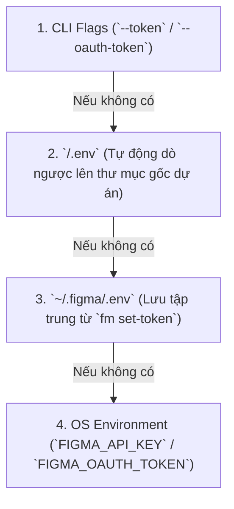

# 📖 Hướng dẫn Sử dụng Chi tiết `figma-cli` (`fm`)

Tài liệu hướng dẫn toàn diện từ A-Z về cài đặt, cấu hình, quản lý token, trích xuất cấu trúc thiết kế Figma và tải tài nguyên hình ảnh/SVG cho **lập trình viên** và **AI Coding Agent** (Google Antigravity, Claude Code, OpenAI Codex CLI, Cursor, Windsurf, Copilot, OpenCode, Cline,...).

---

## 📑 Mục lục

1. [🔑 Hướng dẫn Lấy Figma Access Token (PAT / OAuth)](#1--hướng-dẫn-lấy-figma-access-token-pat--oauth)
2. [🚀 Phương thức Cài đặt Chi tiết](#2--phương-thức-cài-đặt-chi-tiết)
   - [Cách 1 (Khuyên dùng): Cài đặt qua `npx skills`](#cách-1-khuyên-dùng-cài-đặt-qua-npx-skills-add-g)
   - [Cách 2: Tải Binary biên dịch sẵn từ GitHub Releases](#cách-2-tải-binary-biên-dịch-sẵn-từ-github-releases)
   - [Cách 3: Biên dịch từ mã nguồn (Build from Source)](#cách-3-biên-dịch-từ-mã-nguồn-build-from-source)
3. [⚙️ Quản lý Token & Thứ tự Ưu tiên Cấu hình](#3-️-quản-lý-token--thứ-tự-ưu-tiên-cấu-hình)
4. [📋 Danh mục Command & Flags Toàn cục](#4--danh-mục-command--flags-toàn-cục)
5. [🖥️ Hướng dẫn Chi tiết từng Lệnh](#5-️-hướng-dẫn-chi-tiết-từng-lệnh)
   - [`fm install` — Cài đặt Universal Agent Skill](#fm-install--cài-đặt-universal-agent-skill)
   - [`fm set-token` — Lưu Access Token an toàn](#fm-set-token--lưu-access-token-an-toàn)
   - [`fm fetch` — Trích xuất & Tối ưu Cây Thiết kế](#fm-fetch--trích-xuất--tối-ưu-cây-thiết-kế)
   - [`fm tokens` — Trích xuất Design Tokens (CSS / Tailwind / JSON)](#fm-tokens--trích-xuất-design-tokens-css--tailwind--json)
   - [`fm download` — Tải & Cắt Tài nguyên Đa luồng](#fm-download--tải--cắt-tài-nguyên-đa-luồng)
   - [`fm link` — Quản lý Dev Resources & Code Links](#fm-link--quản-lý-dev-resources--code-links)
   - [`fm update` — Tự động Cập nhật Phiên bản Mới](#fm-update--tự-động-cập-nhật-phiên-bản-mới)
   - [`fm version` & `fm help`](#fm-version--fm-help)
6. [💡 Best Practices & Kịch bản Tương tác cùng AI Agent](#6--best-practices--kịch-bản-tương-tác-cùng-ai-agent)

---

## 1. 🔑 Hướng dẫn Lấy Figma Access Token (PAT / OAuth)

Để `figma-cli` có thể kết nối với Figma REST API và tải dữ liệu, bạn cần có **Personal Access Token (PAT)** hoặc **OAuth2 Bearer Token**.

### Các bước lấy Personal Access Token (PAT)
1. Đăng nhập tài khoản Figma tại [https://www.figma.com](https://www.figma.com).
2. Nhấn vào **Avatar / Tên tài khoản** ở góc trên bên trái màn hình $\rightarrow$ chọn **Settings** (Cài đặt).
3. Chuyển sang tab **Security** (Bảo mật) $\rightarrow$ cuộn xuống phần **Personal access tokens**.
4. Nhấn nút **Generate new token**:
   - **Token name**: Đặt tên gợi nhớ (ví dụ: `figma-cli` hoặc `antigravity`).
   - **Expiration**: Chọn thời hạn sử dụng mong muốn (ví dụ 90 ngày hoặc No expiration).
   - **Scopes (Quyền hạn)**:
     - **`File content`**: Chọn **`Read`** *(Bắt buộc — dùng để đọc cây thiết kế và xuất ảnh/SVG)*.
     - **`Dev resources`**: Chọn **`Read`** *(Khuyên dùng)*.
5. Nhấn **Generate token** và **sao chép ngay mã token** (bắt đầu bằng `figd_...`). *Lưu ý: Figma chỉ hiển thị mã này 1 lần duy nhất.*
6. Lưu token vào máy tính bằng lệnh:
   ```bash
   fm set-token figd_YOUR_PERSONAL_ACCESS_TOKEN
   ```

---

## 2. 🚀 Phương thức Cài đặt Chi tiết

`figma-cli` là một file thực thi nhị phân tĩnh (**Single Static Binary, `CGO_ENABLED=0`**), không phụ thuộc vào Node.js, Python hay bất kỳ thư viện hệ thống ngoài nào.

### Cách 1 (Khuyên dùng — 1 Command hoàn chỉnh): Cài đặt tự động theo Hệ điều hành

Script cài đặt sẽ tự động nhận diện kiến trúc CPU, tải đúng một binary duy nhất cho OS từ GitHub Releases mới nhất (không làm đầy thư mục bằng binary của OS khác) và tự động thiết lập symlink cho AI Agent theo biến môi trường `IDE`:

#### Trên Linux (Ubuntu / Debian / Arch / Fedora / Alpine)
```bash
# Cài đặt cho Antigravity (hoặc claude, codex, all)
IDE=antigravity curl -fsSL https://raw.githubusercontent.com/ducconit/figma-cli/main/scripts/install-linux.sh | bash
```

#### Trên macOS (Apple Silicon M1/M2/M3/M4)
```bash
IDE=antigravity curl -fsSL https://raw.githubusercontent.com/ducconit/figma-cli/main/scripts/install-darwin.sh | bash
```

#### Trên Windows (PowerShell)
```powershell
$env:IDE="antigravity"; irm https://raw.githubusercontent.com/ducconit/figma-cli/main/scripts/install-windows.ps1 | iex
```

> **Biến môi trường hỗ trợ**:
> - `IDE`: Chọn AI Coding Agent để tạo symlink tự động (`antigravity`, `claude`, `codex`, `cursor`, `windsurf`, `copilot`, `opencode`, `cline`, hoặc `all`). Mặc định là `all`.
> - `TOKEN` hoặc `FIGMA_API_KEY`: Truyền kèm token để script lưu luôn vào `~/.figma/.env` (ví dụ: `IDE=antigravity TOKEN=figd_xxx curl ... | bash`).
> - `SKILL_PATH`: Tùy biến thư mục lưu skill (mặc định: `~/.agents/skills`).

---

### Cách 2: Cài đặt qua `npx skills add -g`

Tự động nạp skill `figma-cli` vào kho skill toàn cục:

```bash
# 1. Thêm skill figma-cli toàn cục (global)
npx skills add ducconit/figma-cli -g

# 2. Cấu hình Figma Personal Access Token
~/.agents/skills/figma-cli/scripts/fm set-token figd_YOUR_PERSONAL_ACCESS_TOKEN
```

*(Nếu chỉ muốn thêm riêng vào thư mục dự án hiện tại, bỏ cờ `-g`: `npx skills add ducconit/figma-cli` $\rightarrow$ `./.agents/skills/figma-cli/scripts/fm set-token ...`)*

---

### Cách 3: Tải Binary biên dịch sẵn từ GitHub Releases

Tải bản phát hành chính thức mới nhất từ [GitHub Releases](https://github.com/ducconit/figma-cli/releases/latest):

#### Trên Linux (Ubuntu / Debian / Fedora / Arch)
```bash
curl -fsSL https://github.com/ducconit/figma-cli/releases/latest/download/fm-linux-amd64 -o fm
chmod +x fm
./fm install --agy --claude --codex
./fm set-token figd_YOUR_PERSONAL_ACCESS_TOKEN
```

#### Trên macOS (Apple Silicon M1/M2/M3/M4)
```bash
curl -fsSL https://github.com/ducconit/figma-cli/releases/latest/download/fm-darwin-arm64 -o fm
chmod +x fm
./fm install --all
./fm set-token figd_YOUR_PERSONAL_ACCESS_TOKEN
```

#### Trên Windows (cmd / PowerShell)
1. Tải file `fm-windows-amd64.exe` từ trang Releases và đổi tên thành `fm.exe`.
2. Mở PowerShell trong thư mục chứa file:
   ```powershell
   .\fm.exe install --all
   .\fm.exe set-token figd_YOUR_PERSONAL_ACCESS_TOKEN
   ```

---

### Cách 4: Biên dịch từ mã nguồn (Build from Source)

Yêu cầu máy đã cài **Go 1.23+**:

```bash
git clone https://github.com/ducconit/figma-cli.git
cd figma-cli

# Biên dịch binary ./fm cho hệ điều hành hiện tại
make build

# Kiểm tra bản build và chạy test
make vet
make test

# Cài đặt skill và liên kết tới các AI Agent
./fm install --all
./fm set-token figd_YOUR_PERSONAL_ACCESS_TOKEN
```

---

## 3. ⚙️ Quản lý Token & Thứ tự Ưu tiên Cấu hình

`fm` giải quyết triệt để sự nhập nhằng về token giữa các môi trường làm việc thông qua **Chuỗi ưu tiên 4 tầng (4-Tier Priority Resolution)**:



1. **CLI Flags**: `--token <PAT>` hoặc `--oauth-token <Bearer>` truyền trực tiếp khi gọi lệnh.
2. **File `.env` của Project**: Tìm kiếm file `.env` tại thư mục làm việc hiện tại và tự động quét ngược lên các thư mục cha cho đến gốc dự án. Nếu project có `FIGMA_API_KEY=...`, token này sẽ được ưu tiên để không ảnh hưởng đến các dự án khác.
3. **File cấu hình toàn cục `~/.figma/.env`**: Nơi lệnh `fm set-token` tự động lưu trữ với quyền bảo mật `0600` (chỉ user hiện tại có quyền đọc/ghi).
4. **Biến môi trường hệ điều hành (OS Env)**: `export FIGMA_API_KEY=figd_...` hoặc `export FIGMA_OAUTH_TOKEN=...`.

---

## 4. 📋 Danh mục Command & Flags Toàn cục

| Command | Cú pháp | Chức năng chính |
| :--- | :--- | :--- |
| **`fm install`** | `fm install [flags]` | Cài đặt Agent Skill vào `~/.agents/skills/figma-cli` (hoặc `--path`) và tạo symlink tự động cho từng Agent. |
| **`fm set-token`** | `fm set-token <token> [--oauth]` | Lưu hoặc cập nhật Access Token vào duy nhất file `~/.figma/.env`. |
| **`fm fetch`** | `fm fetch <url-or-key> [flags]` | Tải và tinh gọn cây thiết kế thành Tree DSL (tiết kiệm 40%–55% token), YAML hoặc JSON. |
| **`fm tokens`** | `fm tokens <url-or-key> [flags]` | Trích xuất Figma Variables thành CSS Variables (`:root`/`.dark`), Tailwind Config JS hoặc JSON. |
| **`fm download`** | `fm download <url-or-key> [flags]` | Tải hình ảnh, GIF và SVG đa luồng. Mặc định lưu vào `/tmp`, hỗ trợ cắt ảnh affine crop. |
| **`fm link`** | `fm link <url-or-key> [flags]` | Gắn, xem danh sách hoặc xóa dev resource links (GitHub PR, Storybook, Jira) trên Figma nodes. |
| **`fm update`** | `fm update [flags]` | Tự động kiểm tra và nâng cấp binary lên phiên bản phát hành mới nhất từ GitHub Releases. |
| **`fm version`** | `fm version [--json]` *(hoặc `fm -v`)* | Hiển thị phiên bản, commit hash, ngày build và thông tin Go runtime. |
| **`fm help`** | `fm -h` / `fm <cmd> -h` | Hiển thị hướng dẫn chi tiết và ví dụ cho từng lệnh. |

### Các Cờ Toàn cục (Global Flags)

- `--token <string>`: Figma Personal Access Token.
- `--oauth-token <string>`: Figma OAuth2 Bearer Token (ưu tiên hơn `--token` nếu cùng truyền).
- `--env <path>`: Đường dẫn trực tiếp tới file `.env` cần tải.
- `--proxy <url|none>`: Chỉ định proxy doanh nghiệp hoặc truyền `--proxy=none` để bỏ qua proxy hệ thống.
- `-h, --help`: Xem trợ giúp.
- `-v, --version`: Xem nhanh phiên bản.

---

## 5. 🖥️ Hướng dẫn Chi tiết từng Lệnh

### `fm install` — Cài đặt Universal Agent Skill

Cài đặt skill `figma-cli` tương thích chuẩn với mọi AI Coding Agent:

```bash
# Cài đặt mặc định vào ~/.agents/skills/figma-cli và tạo symlink cho Antigravity, Claude Code, Codex
./fm install --agy --claude --codex

# Tạo symlink đồng loạt cho TẤT CẢ các AI Agent trên máy
./fm install --all

# Cài đặt riêng cho dự án hiện tại tại .agent/skills
./fm install --path .agent/skills

# Chỉ định đường dẫn tùy biến
./fm install --path /custom/skills --agy
```

#### Bảng tra cứu đường dẫn Symlink của các Agent:
| Cờ tạo Symlink | AI Coding Agent | Đường dẫn symlink đích |
| :--- | :--- | :--- |
| `--antigravity`, `--agy` | **Google Antigravity** | `~/.gemini/config/skills/figma-cli` |
| `--claude` | **Claude Code** | `~/.claude/skills/figma-cli` |
| `--codex` | **OpenAI Codex CLI** | `~/.codex/skills/figma-cli` |
| `--cursor` | **Cursor** | `~/.cursor/skills/figma-cli` |
| `--windsurf` | **Windsurf** | `~/.codeium/windsurf/skills/figma-cli` |
| `--copilot` | **GitHub Copilot** | `~/.copilot/skills/figma-cli` |
| `--opencode` | **OpenCode** | `~/.config/opencode/skills/figma-cli` |
| `--cline` | **Cline** | `~/.cline/skills/figma-cli` |
| `--all`, `-a` | **Tất cả các Agent** | Tạo symlink cho tất cả thư mục trên |

---

### `fm set-token` — Lưu Access Token an toàn

Lưu token vào file `~/.figma/.env` (tạo mới thư mục và file nếu chưa có, thiết lập quyền `0600`):

```bash
# Lưu Personal Access Token (PAT)
fm set-token figd_abcdef1234567890

# Lưu OAuth2 Bearer Token
fm set-token --oauth ya29.a0AfH6SMA...
```

---

### `fm fetch` — Trích xuất & Tối ưu Cây Thiết kế

Trích xuất dữ liệu thiết kế từ Figma và chuyển đổi sang dạng token-optimized:

```bash
# 1. Trích xuất trực tiếp qua URL Figma (tự động phân giải file-key và chuẩn hóa node-id)
fm fetch "https://www.figma.com/design/abc123XYZ/My-Design?node-id=12-34"

# 2. Truyền tham số tường minh qua flag
fm fetch -k abc123XYZ -n 12:34

# 3. Giới hạn độ sâu duyệt cây (depth) đối với các frame thiết kế cực lớn
fm fetch -k abc123XYZ -n 12:34 --depth 3

# 4. Xuất định dạng khác (yaml hoặc json; mặc định là tree)
fm fetch -k abc123XYZ -n 12:34 --format yaml
fm fetch -k abc123XYZ -n 12:34 --json

# 5. Ghi kết quả trực tiếp ra file
fm fetch "https://www.figma.com/design/abc123XYZ/My-Design?node-id=12-34" -o /tmp/checkout.tree
```

#### Định dạng đầu ra Tree DSL:
Tree DSL được tối ưu để tiết kiệm 40%–55% token so với JSON:
- Nhóm biến toàn cục: `GLOBAL_VARS`
- Nhóm phần tử tái sử dụng: `ELEMENTS` (`EL-xxxxxxxx`)
- Cấu trúc phân cấp: `NODES` với cú pháp 1 dòng `[TYPE] "name" #id key=val`

---

### `fm tokens` — Trích xuất Design Tokens (CSS / Tailwind / JSON)

Trích xuất toàn bộ Figma Variables (Design Tokens) bao gồm màu sắc (`COLOR`), kích thước khoảng cách/bo góc (`FLOAT`), chuỗi (`STRING`), logic (`BOOLEAN`) và chế độ theme (Light/Dark hoặc đa chế độ) thông qua Figma Variables REST API:

```bash
# 1. Trích xuất CSS Variables mặc định sang stdout (:root cho Light mode và .dark cho Dark mode)
fm tokens "https://www.figma.com/design/abc123XYZ/Design-System"

# 2. Xuất file CSS hoàn chỉnh sẵn sàng import vào dự án
fm tokens --file-key abc123XYZ --format css -o ./src/styles/tokens.css

# 3. Xuất snippet cấu hình theme extension cho Tailwind CSS
fm tokens --file-key abc123XYZ --format tailwind -o ./tailwind.tokens.js

# 4. Xuất dữ liệu token dạng JSON cấu trúc (đã khử alias loop an toàn)
fm tokens abc123XYZ --format json -o ./tokens.json
```

#### Đặc điểm kỹ thuật của bộ xử lý Tokens:
- **Tự động giải quyết Alias (`VARIABLE_ALIAS`)**: Khi biến A tham chiếu biến B, `fm` tự động truy vết giá trị gốc và giải quyết theo đúng mode tương ứng.
- **Phát hiện & Chặn lặp vô tận (Cycle Detection)**: Tự động phát hiện các vòng lặp tham chiếu chéo (`A -> B -> A`) với ngưỡng độ sâu đệ quy tối đa 20 bước, không bao giờ gây tràn ngăn xếp (stack overflow).
- **Chuẩn hóa Bộ chọn CSS**: Tự động chuyển đổi tên biến Figma có dấu gạch chéo (`Colors/Primary/500`) thành CSS variable hợp lệ (`--colors-primary-500`). Mode "Dark" được tự động gán vào class `.dark`, các mode khác được phân loại vào `[data-theme="..."]`.

---

### `fm download` — Tải & Cắt Tài nguyên Đa luồng

Tải ảnh raster (PNG, JPEG), ảnh động GIF và vector SVG từ Figma:

```bash
# 1. Quét toàn bộ node và tải tất cả tài nguyên về thư mục tạm /tmp mặc định
fm download "https://www.figma.com/design/abc123XYZ/My-Design?node-id=12-34"

# 2. Tải về thư mục dự án chỉ định qua --dir (tự động tạo thư mục nếu chưa có)
fm download "https://www.figma.com/design/abc123XYZ/My-Design?node-id=12-34" --dir ./public/assets

# 3. Tải các tài nguyên cụ thể qua cờ --item (-i)
fm download abc123XYZ --dir ./public/assets \
  --item "nodeId=12:35,file=ic-check.svg" \
  --item "nodeId=12:40,imageRef=8f9a1b2c3d4e,file=hero.png"

# 4. Tải kèm ma trận cắt ảnh (Affine Crop Matrix 2x3) và kích thước cho chế độ TILE
fm download abc123XYZ --dir ./public/assets --manifest '[
  {
    "nodeId": "12:40",
    "imageRef": "8f9a1b2c3d4e",
    "fileName": "hero.png",
    "filenameSuffix": "3a9f1c",
    "needsCropping": true,
    "cropTransform": [[0.5, 0, 0.25], [0, 0.5, 0.1]],
    "requiresImageDimensions": true
  }
]'
```

---

### `fm link` — Quản lý Dev Resources & Code Links

Gắn, xem danh sách hoặc gỡ bỏ các liên kết tài nguyên phát triển (GitHub Pull Requests, Storybook Stories, Jira Tickets, tài liệu kỹ thuật) trực tiếp trên từng Figma node thông qua Figma Dev Resources REST API (Dev Mode):

```bash
# 1. Gắn link GitHub PR hoặc Storybook vào một Figma node cụ thể
fm link "https://www.figma.com/design/abc123XYZ/App?node-id=12-34" \
  --url "https://github.com/org/repo/pull/42" \
  --name "PR #42: Header Component Implementation"

# 2. Liệt kê danh sách tất cả dev resources đã gắn trên file hoặc node
fm link "https://www.figma.com/design/abc123XYZ/App?node-id=12-34" --list
fm link --file-key abc123XYZ --list --json

# 3. Xóa một dev resource theo ID
fm link --file-key abc123XYZ --delete 98765
```

---

### `fm update` — Tự động Cập nhật Phiên bản Mới

Kiểm tra và tự động cập nhật `fm` lên phiên bản mới nhất phát hành trên [GitHub Releases](https://github.com/ducconit/figma-cli/releases):

```bash
# 1. Tự động kiểm tra và tải bản cập nhật mới nhất (ghi đè binary an toàn)
fm update

# 2. Chỉ kiểm tra xem có bản mới hay không mà không tải
fm update --check

# 3. Ép buộc tải lại ngay cả khi đã ở phiên bản mới nhất
fm update --force

# 4. Cài đặt hoặc hạ cấp về một phiên bản/tag cụ thể
fm update --version v0.0.2

# 5. Xuất kết quả kiểm tra dưới dạng JSON (tiện cho script tự động hóa)
fm update --check --json
```

---

### `fm version` & `fm help`

```bash
# Xem phiên bản, OS/Arch và commit hash
fm version

# Xem phiên bản định dạng JSON
fm version --json

# Xem trợ giúp chung hoặc trợ giúp cho từng lệnh
fm -h
fm fetch -h
fm update -h
```

---

## 6. 💡 Best Practices & Kịch bản Tương tác cùng AI Agent

### Kịch bản 1: Prompting cho AI Agent (Antigravity / Claude Code / Cursor)
Khi bạn muốn AI Agent tạo giao diện mới từ Figma, chỉ cần gửi URL Figma kèm câu lệnh đơn giản:

> *"Hãy xem thiết kế Figma tại `https://www.figma.com/design/abc123XYZ/App?node-id=10-20` và tạo component Vue 3 + Tailwind CSS hoàn chỉnh, tải ảnh về `./src/assets/images`."*

AI Agent sẽ tự động:
1. Nhận diện URL Figma và kích hoạt skill `figma-cli`.
2. Gọi `fm fetch <url>` để trích xuất cấu trúc bố cục, kiểu chữ, mã màu và Flexbox/CSS Grid.
3. Gọi `fm download <url> --dir ./src/assets/images` để tải tài nguyên SVG/PNG.
4. Sinh mã nguồn frontend sạch đẹp, bám sát 100% thiết kế gốc.

### Kịch bản 2: Tối ưu Token Context Window
Đối với các màn hình dashboard phức tạp gồm nhiều tầng container:
- Sử dụng cờ `--depth 3` để AI nắm bắt trước bộ khung tổng thể (layout skeleton).
- Sau đó trích xuất sâu vào từng component con cụ thể thông qua `node-id` riêng.

### Kịch bản 3: CI/CD & Tự động Hóa
Nhờ khả năng chạy không cần headless browser hay runtime nặng nề, bạn có thể tích hợp `fm` vào GitHub Actions để tự động kiểm tra xem các icon SVG trong repo có đồng bộ với file thiết kế Figma mới nhất hay không.
