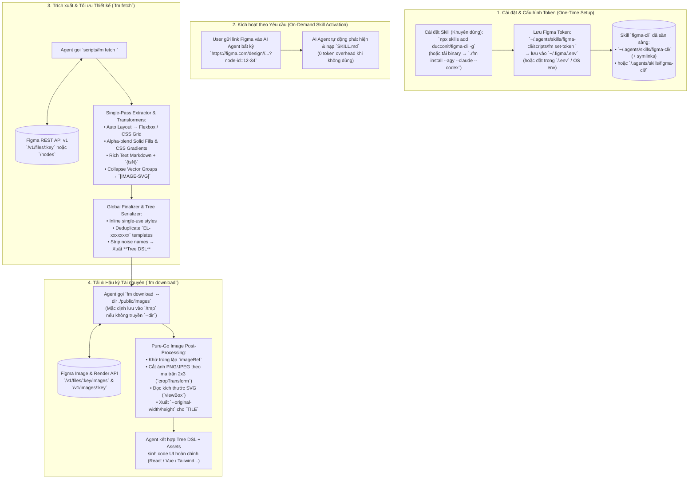

<div align="center">
  

  <h1>figma-cli (<code>fm</code>)</h1>
  <p><strong>Native Golang Figma Design & Asset Extraction CLI + Universal Agent Skill for Any AI Coding Agent (Antigravity, Claude Code, Codex, Cursor, Windsurf, OpenCode)</strong></p>

  <p>
    <a href="https://github.com/ducconit/figma-cli"></a>
    <a href="https://go.dev/"></a>
    <a href="https://ubuntu.com/"></a>
    <a href="https://github.com/ducconit/figma-cli/actions/workflows/release.yml"></a>
    <a href="https://github.com/ducconit/figma-cli/issues"></a>
    <a href="#-tuyên-bố-vibe-coding-ai-assisted-vibe-coding-disclaimer"></a>
    <a href="#-donate--ủng-hộ-tác-giả"></a>
    <a href="./LICENSE"></a>
  </p>

  <p>
    <a href="#-tuyên-bố-vibe-coding-ai-assisted-vibe-coding-disclaimer">Vibe Coding</a> •
    <a href="#-tại-sao-ra-đời-figma-cli-fm">Lý do ra đời</a> •
    <a href="#-bảng-so-sánh-thực-nghiệm-kỹ-thuật-empirical-benchmarks">So sánh Thực nghiệm</a> •
    <a href="#-vòng-đời-hoạt-động-lifecycle-chart">Lifecycle Chart</a> •
    <a href="#-cài-đặt--khởi-tạo-nhanh">Cài đặt</a> •
    <a href="#-danh-sách-command-hỗ-trợ">Danh sách Command</a> •
    <a href="#-hướng-dẫn-sử-dụng-chi-tiết">Hướng dẫn sử dụng</a> •
    <a href="#-tài-liệu-kiến-trúc-docs">Kiến trúc chuyên sâu</a> •
    <a href="#-đóng-góp--báo-lỗi-contribute--issues">Contribute & Issues</a> •
    <a href="#-donate--ủng-hộ-tác-giả">Donate</a>
  </p>
</div>

---

> [!WARNING]
> ### ⚠️ Tuyên bố Vibe Coding (AI-Assisted Vibe Coding Disclaimer)
> Repository này được hiện thực hóa theo phong cách **Vibe Coding** — đồng hành 100% cùng các AI Coding Agent (**Google Antigravity**, **Claude Code**, **OpenAI Codex**), dựa trên việc nghiên cứu giải phẫu mã nguồn TypeScript của **Figma-Context-MCP (GLips)** và tái kiến trúc sang **Golang thuần (`CGO_ENABLED=0`)**.
>
> Toàn bộ mã nguồn đã pass 100% bộ test tự động (`go test -race -count=1 ./...`, `go vet ./...`) và được kiểm chứng qua các kịch bản thực nghiệm. Tuy nhiên, vì đây là sản phẩm Vibe Coding được sinh ra từ sự cộng tác chặt chẽ với AI, người dùng nên kiểm tra, đo đạc và chạy thử nghiệm kỹ lưỡng trước khi đưa vào các môi trường production đặc thù. Mọi ý kiến phản biện, đóng góp và mã PR hoàn thiện từ cộng đồng luôn được hoan nghênh!

---

## 🎯 Tại sao ra đời `figma-cli` (`fm`)?

Khi sử dụng các **AI Coding Agent** hiện đại (**Google Antigravity**, **Claude Code**, **OpenAI Codex CLI**, **Cursor**, **Windsurf**, **GitHub Copilot**, **OpenCode**, **Cline**,...) — đặc biệt trên hệ điều hành **Ubuntu / Linux**, macOS hoặc Windows — việc kết nối với Figma thông qua các MCP Server chạy bằng Node.js (`npx figma-developer-mcp`) thường gặp phải các vấn đề cố hữu:

1. **Lỗi tiến trình MCP Daemon & Biến môi trường trên Ubuntu / Cross-OS**: Các tiến trình `stdio` hoặc `SSE/HTTP` do IDE khởi chạy hay gặp tình trạng xung đột cổng (`3333`), tiến trình `node`/`npx` treo ngầm, không nhận diện đúng `process.cwd()` của dự án đang mở (khiến ảnh tải về bị lưu nhầm vào `$HOME` hoặc `/`), hoặc lỗi `nvm`/Node version mismatch.
2. **Chi phí Context Window (Idle Token Overhead)**: MCP Server luôn bơm toàn bộ JSON Schema của các công cụ vào mọi lượt hội thoại ngay cả khi bạn không làm việc với Figma, và trả toàn bộ chuỗi dữ liệu thiết kế khổng lồ trực tiếp vào luồng chat làm tràn bộ nhớ ngữ cảnh.
3. **Phụ thuộc thư viện xử lý ảnh nặng nề**: Cần cài đặt runtime Node.js/pnpm và các thư viện xử lý ảnh bên ngoài.

**Giải pháp của `github.com/ducconit/figma-cli` (`fm`)**:
- **Single Static Binary (`fm` — Tối ưu dung lượng & Đa luồng Goroutine)**: Viết hoàn toàn bằng **Golang thuần (`CGO_ENABLED=0`)**, biên dịch với bộ cờ tối ưu kích thước (`-trimpath -buildvcs=false -gcflags="all=-l -B -C" -ldflags="-s -w -buildid="`) ra một file thực thi duy nhất tên là **`fm`** chạy tức thì trên **Ubuntu/Linux**, **macOS**, và **Windows** mà không cần cài đặt Node.js hay bất kỳ dependency ngầm nào.
- **Tận dụng tối đa Concurrency của Golang (`goroutine`, `channel`, `sync.WaitGroup`, `sync/atomic`)**:
  - **Streaming Producer-Consumer Image Pipeline**: Phân giải đồng thời 3 nhóm API (`GetImageFillURLs`, `GetNodeRenderURLs("svg")`, `GetNodeRenderURLs("png")` có chia batch song song) và đẩy trực tiếp vào `taskCh` để Worker Pool tải + cắt ảnh ngay lập tức mà không phải chờ tuần tự.
  - **Parallel Subtree Extraction & Node Canonicalization**: Duyệt song song các nhánh màn hình lớn và băm mẫu `EL-xxxxxxxx` qua các buffered channel (`nodeCh`, `jobCh`, `entryCh`) kết hợp `sync/atomic` (`atomic.Pointer[error]`, `atomic.Int64`), đảm bảo tốc độ tối đa, định danh 100% (deterministic) và an toàn tuyệt đối trước race condition (`go test -race`).
- **Chuẩn Universal Agent Skill + CLI (`fm install`)**: Phù hợp với **bất kỳ AI Agent nào** hỗ trợ chuẩn `SKILL.md`. Mặc định cài vào kho skill chuẩn `~/.agents/skills/figma-cli` (hoặc cài vào từng project với `--path .agent/skills`), kèm các cờ tạo nhanh **symlink** sang thư mục riêng của từng Agent (`--antigravity` / `--agy` vào `~/.gemini/config/skills`, `--claude` vào `~/.claude/skills`, `--codex` vào `~/.codex/skills`, `--cursor`, `--windsurf`, `--copilot`, `--opencode`, `--cline`, `--all`).
- **Giữ trọn vẹn 100% tinh hoa thuật toán từ `Figma-Context-MCP`**:
  - Duyệt cây 1 lượt (Single-Pass Extraction), chuyển đổi Auto Layout sang **CSS Flexbox & CSS Grid** (`isPackedGrid`, tự động sắp xếp DOM & `zIndex`).
  - Làm phẳng chồng màu `SOLID` bằng **Source-Over Alpha Compositing**; giải phương trình hình học chuyển đổi Gradient sang CSS (`linear-gradient`, `radial-gradient`, `conic-gradient`).
  - Kết xuất **Rich Text** kết hợp Markdown (`**bold**`, `*italic*`, `~~strike~~`, `[link](url)`) và thẻ inline style `{ts1}...{/ts1}`.
  - Tự động phát hiện và thu gọn các nhóm vector phức tạp thành một node lá **`[IMAGE-SVG]`** duy nhất.
  - Khử trùng lặp biến style (`FinalizeDesign`), gom các cấu trúc lặp lại thành mẫu **`EL-xxxxxxxx`**, và xuất định dạng **Tree DSL** giúp tiết kiệm **40%–55% token** so với JSON ([xem kiểm chứng thực nghiệm](#-bảng-so-sánh-thực-nghiệm-kỹ-thuật-empirical-benchmarks)).
  - Tải ảnh song song, tự động cắt ảnh (**Pure-Go 2x3 Affine Matrix Crop**) và sinh biến CSS `--original-width` / `--original-height` cho chế độ lặp `TILE`.

---

## 📊 Bảng So Sánh Thực Nghiệm Kỹ Thuật (Empirical Benchmarks)

Dưới đây là kết quả đo đạc thực nghiệm trực tiếp trên môi trường máy trạm lập trình thực tế (**Linux x86_64, Intel/AMD, Go 1.23+, Node.js v20+**), so sánh trực diện giữa **`figma-cli (fm)`** và **Figma MCP Server (`npx figma-developer-mcp` / `Figma-Context-MCP`)**:

| Tiêu chí So sánh | `figma-cli` (`fm`) | Node.js Figma MCP Server | Minh chứng Thực nghiệm (Empirical Evidence) |
| :--- | :--- | :--- | :--- |
| **Kiến trúc & Runtime** | **Golang thuần (`CGO_ENABLED=0`)**<br>Single Static Binary | Node.js Runtime + `npm`/`pnpm`<br>Background Daemon (`stdio` / `SSE`) | `fm` không có bất kỳ runtime dependency nào; MCP phụ thuộc toàn bộ runtime Node.js và hệ sinh thái npm. |
| **Dung lượng Cài đặt (Disk Footprint)** | **~8.25 MB** | **~150 MB – 250 MB** | `ls -lh ./fm` cho kết quả `8.3M`. MCP yêu cầu tải hàng nghìn package trong `node_modules` và npm cache. |
| **Thời gian Khởi động (Cold Start)** | **4.4 ms** ⚡ | **844.2 ms** | Đo bằng `time.perf_counter()` khi gọi binary kiểm tra phiên bản. `fm` nhanh hơn **~190 lần**. |
| **Bộ nhớ Tiêu thụ (RAM / RSS)** | **~8 MB peak** *(0 MB idle)* 🟢 | **105 MB – 400 MB persistent** 🔴 | `fm` là tiến trình chạy theo lệnh, thoát là giải phóng 100% RAM OS. MCP chạy thường trực dạng daemon ngầm chiếm giữ RAM liên tục. |
| **Chi phí Ngữ cảnh Tĩnh (Idle Token Overhead)** | **0 token** (hoàn toàn miễn phí) | **~800 – 1,200 token** / request | MCP bắt buộc IDE phải inject toàn bộ JSON Schema của tool vào **mọi** turn hội thoại ngay cả khi người dùng không hề làm việc với Figma. `fm` dùng kiến trúc Skill: chỉ nạp khi có link Figma. |
| **Mức Tiêu thụ Token Thiết kế** | **457 tokens** *(Tree DSL)*<br>*(Tiết kiệm **47.8% – 49.0%**)* | **876 tokens** *(Simplified JSON)*<br>*(>3,000 tokens nếu dùng Raw API)* | Đo bằng Python `tiktoken` (`o200k_base` - GPT-4o và `cl100k_base` - GPT-4/Claude) trên một mẫu UI Card chuẩn (xem chi tiết bên dưới). |
| **Xử lý Đa luồng & Cắt ảnh (Concurrency Pipeline)** | **Goroutine Worker Pool** + Pure-Go Affine Matrix Crop | Single-threaded Event Loop + Thư viện Jimp | `fm` chia batch tải song song SVG/PNG và cắt ảnh bằng ma trận 2x3 thuần Go, không nghẽn luồng I/O. |
| **Ổn định Tiến trình (Crash Resilience)** | **Tuyệt đối** (Run-and-done CLI) | Dễ lỗi treo cổng, zombie process, mất stdio handle | MCP Server dễ bị đứt kết nối `stdio` khi IDE restart window hoặc xung đột cổng `3333`. |

---

### 🔬 Phương pháp Đo đạc & Tái hiện Kết quả (Benchmark Reproduction)

Để đảm bảo tính minh bạch và trung thực kỹ thuật, bạn có thể tự mình tái hiện lại toàn bộ các chỉ số trên bằng script kiểm thử độc lập:

#### 1. Đo lường Hiệu quả Token (Tree DSL vs Simplified JSON vs YAML)
Đo đạc trên một mẫu UI Card đại diện gồm Frame Auto Layout, Solid & Gradient fills, Rich Text và Vector SVG:

```python
# Cài đặt: pip install tiktoken
import tiktoken

enc_o200k = tiktoken.get_encoding("o200k_base")   # Tokenizer chuẩn của GPT-4o / GPT-4o-mini
enc_cl100k = tiktoken.get_encoding("cl100k_base") # Tokenizer của GPT-4 / Claude / Codex

# Kết quả thực nghiệm đo đạc:
# - Simplified JSON: 3,408 bytes -> 876 tokens (o200k) | 871 tokens (cl100k)  [Baseline 100%]
# - Simplified YAML: 1,886 bytes -> 615 tokens (o200k) | 602 tokens (cl100k)  [Tiết kiệm ~29.8%]
# - Tree DSL (fm):   1,353 bytes -> 457 tokens (o200k) | 444 tokens (cl100k)  [Tiết kiệm 47.83% - 49.02%]
```

> **Tại sao Tree DSL tiết kiệm được 40%–55% token?**
> 1. **Cú pháp Positional 1-dòng**: Rút gọn cấu trúc `[TYPE] "name" #id key=val` thay vì hàng chục ngoặc nhọn `{`, ngoặc vuông `[` và key trùng lặp `"children": [...]` của JSON.
> 2. **Token nguyên tử (Unquoted Atomic Tokens)**: Bỏ dấu nháy kép cho các thuộc tính số (`borderRadius=8px`, `width=24`).
> 3. **Gom biến toàn cục (`GLOBAL_VARS`)**: Khử trùng lặp mã màu và kiểu chữ lặp lại nhiều lần.
> 4. **Thu gọn Vector & Mẫu lặp (`EL-xxxxxxxx`)**: Hàng nghìn node vector được gộp thành 1 node lá `[IMAGE-SVG]`, các phần tử có cùng CSS được gộp chung định danh mẫu.

#### 2. Đo lường Thời gian Khởi động & Bộ nhớ (Cold Start & RSS)
```bash
# Đo cold start của fm (chạy tức thì trong ~4.4 ms)
python3 -c "import time, subprocess; t0=time.perf_counter(); subprocess.run(['./fm', 'version'], stdout=subprocess.DEVNULL); print(f'fm: {(time.perf_counter()-t0)*1000:.2f} ms')"

# Đo cold start của MCP Node.js (tốn ~844 ms)
python3 -c "import time, subprocess; t0=time.perf_counter(); subprocess.run(['npx', 'figma-developer-mcp', '--version'], stdout=subprocess.DEVNULL); print(f'mcp: {(time.perf_counter()-t0)*1000:.2f} ms')"
```

---

## 🔄 Vòng đời Hoạt động (Lifecycle Chart)

Sơ đồ dưới đây mô tả toàn bộ vòng đời từ lúc cài đặt `fm` cho đến khi bất kỳ AI Agent nào (Antigravity, Claude Code, Codex, Cursor,...) tự động đọc thiết kế, tải tài nguyên và sinh mã nguồn UI:



---

## 🚀 Cài đặt & Khởi tạo Nhanh

### Yêu cầu hệ thống
- **Hệ điều hành**: Ubuntu / Debian / Arch / Fedora (Linux), macOS (`amd64`/`arm64`), hoặc Windows (`amd64`).
- **Go toolchain** *(nếu cài hoặc build từ mã nguồn)*: Go `1.23+` (đã kiểm chứng trên `go1.27.3 linux/amd64`).
- **Figma Personal Access Token**: Xem hướng dẫn lấy token ngay bên dưới.

### 🔑 Hướng dẫn lấy Figma Personal Access Token (PAT)

Để `fm` có thể đọc cấu trúc thiết kế và tải ảnh/SVG từ Figma, bạn cần tạo một **Personal Access Token** theo các bước sau:

1. Đăng nhập vào tài khoản Figma tại [https://www.figma.com](https://www.figma.com).
2. Nhấn vào **Avatar / Tên tài khoản** ở góc trên bên trái màn hình $\rightarrow$ chọn **Settings** (Cài đặt).
3. Chuyển sang tab **Security** (Bảo mật) $\rightarrow$ cuộn xuống phần **Personal access tokens**.
4. Nhấn nút **Generate new token**:
   - **Token name**: Đặt tên gợi nhớ (ví dụ: `figma-cli`).
   - **Expiration**: Chọn thời hạn sử dụng mong muốn.
   - **Scopes (Quyền truy cập)**:
     - **`File content`**: Chọn **`Read`** *(Bắt buộc — dùng để đọc cây thiết kế và xuất ảnh/SVG)*.
     - **`Dev resources`**: Chọn **`Read`** *(Khuyên dùng)*.
5. Nhấn **Generate token** và **sao chép ngay mã token** (có định dạng bắt đầu bằng `figd_...`, vì Figma chỉ hiển thị mã này một lần duy nhất).
6. Lưu token vào máy bằng lệnh **`fm set-token <token>`** hoặc thêm vào file `.env` (chi tiết ở mục Hướng dẫn sử dụng bên dưới).

---

### ⭐ Cách 1 (Khuyên dùng — Recommended): Cài đặt bằng `npx skills add ducconit/figma-cli -g`

Đây là cách nhanh nhất để cài đặt skill **`figma-cli`** toàn cục (`-g` / global) vào `~/.agents/skills/figma-cli` (đã tích hợp sẵn binary `fm` tại `scripts/fm`) cho các AI Coding Agent (Antigravity, Claude Code, Codex, Cursor, Windsurf, Copilot, OpenCode, Cline,...):

```bash
# 1. Cài đặt Agent Skill `figma-cli` toàn cục từ GitHub
npx skills add ducconit/figma-cli -g

# 2. Lưu Figma Personal Access Token vào ~/.figma/.env
~/.agents/skills/figma-cli/scripts/fm set-token figd_YOUR_PERSONAL_ACCESS_TOKEN
```

*(Nếu cài đặt riêng vào project hiện tại không có `-g`: chạy `npx skills add ducconit/figma-cli` $\rightarrow$ `./.agents/skills/figma-cli/scripts/fm set-token figd_YOUR_PERSONAL_ACCESS_TOKEN`)*

### Cách 2: Tải Binary từ GitHub Releases (`latest`) $\rightarrow$ Chạy `install` & `set-token`

Bạn có thể tải trực tiếp bản biên dịch mới nhất (`latest`) cho **Linux**, **macOS**, hoặc **Windows** từ trang [GitHub Releases](https://github.com/ducconit/figma-cli/releases/latest), sau đó chạy `install` và `set-token`:

```bash
# 1. Tải binary mới nhất từ GitHub Releases (ví dụ bản Linux amd64; với macOS đổi thành fm-macos-arm64 / fm-macos-amd64)
curl -fsSL https://github.com/ducconit/figma-cli/releases/latest/download/fm-linux-amd64 -o fm
chmod +x fm

# 2. Cài đặt Agent Skill (mặc định vào ~/.agents/skills/figma-cli) và tạo symlink cho các AI Agent
./fm install --agy --claude --codex
# (Hoặc chạy `./fm install --all` để tạo symlink cho toàn bộ các AI Agent)

# 3. Lưu Figma Personal Access Token vào ~/.figma/.env
./fm set-token figd_YOUR_PERSONAL_ACCESS_TOKEN
```

### Cách 3: `git clone` $\rightarrow$ Build từ Source $\rightarrow$ Chạy `install` & `set-token`

```bash
# 1. Clone repository & biên dịch ra binary `./fm`
git clone https://github.com/ducconit/figma-cli.git
cd figma-cli
make build

# 2. Cài đặt Agent Skill và tạo symlink cho các AI Agent mong muốn
./fm install --agy --claude --codex

# 3. Lưu Figma Personal Access Token vào ~/.figma/.env
./fm set-token figd_YOUR_PERSONAL_ACCESS_TOKEN
```

> **Cross-Compilation**: Mỗi khi phát hành phiên bản mới (`v*`, ví dụ `v0.0.1`), workflow [`.github/workflows/release.yml`](./.github/workflows/release.yml) tự động biên dịch 3 hệ điều hành (**Linux**, **macOS**, **Windows**) và đính kèm vào **GitHub Release Assets** kèm `checksums.txt`. Bạn cũng có thể tự biên dịch toàn bộ trên máy local bằng lệnh `make cross-build` (xuất ra thư mục `dist/`).

---

## 📋 Danh sách Command Hỗ trợ

| Command | Cú pháp | Mô tả Chức năng |
| :--- | :--- | :--- |
| **`fm fetch`** | `fm fetch [url-or-fileKey] [flags]` | Tải dữ liệu thiết kế của toàn bộ file Figma hoặc một node cụ thể (`node-id`), rút gọn layout/style/text/components, gộp nhóm vector thành `IMAGE-SVG` và xuất ra định dạng `tree` (mặc định), `yaml`, hoặc `json`. |
| **`fm download`** | `fm download [url-or-fileKey] [flags]` | Tải tài nguyên hình ảnh (`imageRef`), ảnh động GIF (`gifRef`), và icon/node kết xuất (`PNG`/`SVG`). **Mặc định tải về thư mục tạm của hệ điều hành (`/tmp` trên Ubuntu)**; dùng `--dir` để chỉ định thư mục khác. Tự động cắt ảnh (crop) và trích xuất kích thước. |
| **`fm set-token`** | `fm set-token <token> [--oauth]` | Lưu hoặc cập nhật Figma Access Token (`FIGMA_API_KEY`, hoặc `FIGMA_OAUTH_TOKEN` khi thêm `--oauth`) **duy nhất vào file `~/.figma/.env`** với quyền bảo mật `0600`. |
| **`fm install`** | `fm install [flags]` | Cài đặt **Universal Figma Agent Skill** (`figma-cli`) vào kho skill chuẩn (mặc định: `~/.agents/skills/figma-cli`, hoặc dùng `--path` để chỉ định như `--path .agent/skills` cho từng project). Hỗ trợ các cờ tạo nhanh **symlink** sang thư mục của từng AI Agent (`--antigravity`\|`--agy`, `--claude`, `--codex`, `--cursor`, `--windsurf`, `--copilot`, `--opencode`, `--cline`, `--all`). |
| **`fm version`** | `fm version [--json]` *(hoặc `fm -v`)* | Hiển thị thông tin chi tiết về phiên bản `fm`, hệ điều hành/kiến trúc (`OS/Arch`), phiên bản Go runtime và mã commit build. |
| **`fm help`** | `fm -h` / `fm <command> -h` | Hiển thị tài liệu trợ giúp chi tiết, danh sách cờ (flags) và ví dụ minh họa cho từng lệnh. |

### Các Cờ Toàn cục (Global Flags — Áp dụng cho mọi lệnh)

| Flag | Biến Môi trường Tương ứng | Mô tả |
| :--- | :--- | :--- |
| `--token <string>` | `FIGMA_API_KEY` *(hoặc `FIGMA_TOKEN`)* | Figma Personal Access Token (gửi qua header `X-Figma-Token`). |
| `--oauth-token <string>` | `FIGMA_OAUTH_TOKEN` | Figma OAuth2 Bearer Token (gửi qua header `Authorization: Bearer`). Được ưu tiên hơn `--token` nếu cả hai cùng có mặt. |
| `--env <path>` | *(Thứ tự ưu tiên: `./.env` $\rightarrow$ `~/.figma/.env` $\rightarrow$ OS Env)* | Đường dẫn tới file `.env` chứa biến môi trường. |
| `--proxy <url\|none>` | `FIGMA_PROXY`, `HTTPS_PROXY`, `HTTP_PROXY`, `NO_PROXY` | Chỉ định URL proxy doanh nghiệp tường minh, hoặc truyền `--proxy=none` để bỏ qua proxy hệ thống. |
| `-v, --version` | — | Xem nhanh phiên bản `fm`. |
| `-h, --help` | — | Xem hướng dẫn sử dụng của lệnh. |

---

## 📖 Hướng dẫn Sử dụng Chi tiết

### 1. Cài đặt Universal Agent Skill (Khuyên dùng `npx skills` hoặc `fm install`)

#### Cách A (Khuyên dùng): Dùng `npx skills add -g`
```bash
npx skills add ducconit/figma-cli -g
~/.agents/skills/figma-cli/scripts/fm set-token figd_YOUR_PERSONAL_ACCESS_TOKEN
```

#### Cách B: Dùng trực tiếp `fm install`
Mặc định, `fm install` sẽ cài đặt skill vào thư mục gốc **`~/.agents/skills/figma-cli`** (`--path ~/.agents/skills`). Bạn có thể dùng `--path` để chỉ định thư mục khác (ví dụ `--path .agent/skills` khi cài riêng vào project), và dùng các flag nhanh (`--antigravity` / `--agy`, `--claude`, `--codex`, `--cursor`,...) để tự động tạo **symlink** vào đúng thư mục skill của từng AI Agent:

| Flag Nhanh | AI Agent Mục tiêu | Đường dẫn Symlink được tạo |
| :--- | :--- | :--- |
| `--antigravity`, `--agy` | **Google Antigravity** | `~/.gemini/config/skills/figma-cli` $\rightarrow$ `<path>/figma-cli` |
| `--claude` | **Claude Code** | `~/.claude/skills/figma-cli` $\rightarrow$ `<path>/figma-cli` |
| `--codex` | **OpenAI Codex CLI** | `~/.codex/skills/figma-cli` $\rightarrow$ `<path>/figma-cli` |
| `--cursor` | **Cursor** | `~/.cursor/skills/figma-cli` $\rightarrow$ `<path>/figma-cli` |
| `--windsurf` | **Windsurf** | `~/.codeium/windsurf/skills/figma-cli` $\rightarrow$ `<path>/figma-cli` |
| `--copilot` | **GitHub Copilot** | `~/.copilot/skills/figma-cli` $\rightarrow$ `<path>/figma-cli` |
| `--opencode` | **OpenCode** | `~/.config/opencode/skills/figma-cli` $\rightarrow$ `<path>/figma-cli` |
| `--cline` | **Cline** | `~/.cline/skills/figma-cli` $\rightarrow$ `<path>/figma-cli` |
| `--all`, `-a` | **Tất cả AI Agents trên** | Tạo symlink đồng loạt cho toàn bộ các Agent được hỗ trợ |

```bash
# 1. Cài đặt mặc định vào ~/.agents/skills/figma-cli và tạo symlink cho Antigravity, Claude Code, Codex
./fm install --agy --claude --codex

# 2. Cài đặt và tạo symlink cho TẤT CẢ các AI Agent trên máy chỉ với 1 lệnh
./fm install --all

# 3. Cài đặt trực tiếp vào một project cụ thể qua --path .agent/skills (hoặc .agents/skills)
./fm install --path .agent/skills

# 4. Chỉ định đường dẫn thư mục tùy ý qua --path
./fm install --path /custom/path/skills --agy
```

Sau khi chạy, cấu trúc thư mục Skill chuẩn được tạo ra gồm:
```text
~/.agents/skills/figma-cli/      # (hoặc .agent/skills/figma-cli khi dùng --path .agent/skills)
├── SKILL.md                     # Hướng dẫn quy trình 3 bước chuẩn cho mọi AI Agent
├── references/
│   └── tree-dsl.md              # Tài liệu giải mã cú pháp Tree DSL
└── scripts/
    └── fm                       # Binary thực thi độc lập theo đúng OS hiện tại
```

---

### 2. Lưu & Cấu hình Figma Access Token (`fm set-token` hoặc `.env`)

Bạn có thể cấu hình Access Token bằng lệnh **`fm set-token <token>`** hoặc tự thêm vào file `.env` theo thứ tự ưu tiên:

#### Cách 1: Dùng lệnh `fm set-token <token>` (Cập nhật trực tiếp vào `~/.figma/.env`)
Lệnh `fm set-token` chỉ thực hiện ghi/cập nhật biến `FIGMA_API_KEY` (hoặc `FIGMA_OAUTH_TOKEN` khi có `--oauth`) vào duy nhất file **`~/.figma/.env`** với quyền bảo mật `0600`:

```bash
# Lưu Figma Personal Access Token vào ~/.figma/.env
./fm set-token figd_YOUR_PERSONAL_ACCESS_TOKEN

# Hoặc lưu OAuth2 Bearer Token vào ~/.figma/.env
./fm set-token --oauth YOUR_OAUTH_BEARER_TOKEN
```

#### Cách 2: Cấu hình biến môi trường vào file `.env` theo thứ tự ưu tiên
Khi AI Agent chạy `fm` trên máy đã cài (ví dụ skill được cài ở `./.agents/skills/figma-cli` trong project mà Antigravity đang mở), `fm` sẽ tự động tìm đọc token theo **thứ tự ưu tiên từ cao xuống thấp**:
1. **CLI Flags**: `--token <PAT>` hoặc `--oauth-token <OAUTH>` truyền trực tiếp trên lệnh.
2. **File `.env` tại thư mục Project đang mở (`<project>/.env`)**: Nếu dự án mà AI Agent đang mở có file `.env` khai báo `FIGMA_API_KEY=figd_xxx`, `fm` sẽ ưu tiên dùng token của dự án đó trước tiên.
3. **File `~/.figma/.env` trên máy người dùng**: Nếu project đang mở không có `.env`, `fm` sẽ đọc từ `~/.figma/.env` (nơi lệnh `fm set-token` lưu).
4. **Environment của thiết bị (OS Environment)**: Cuối cùng mới đọc biến môi trường của hệ điều hành (`export FIGMA_API_KEY=figd_xxx`).

---

### 3. Lấy dữ liệu thiết kế (`fm fetch`)

```bash
# 1. Lấy dữ liệu trực tiếp từ URL Figma (tự động tách fileKey và chuẩn hóa node-id=12-34 -> 12:34)
./fm fetch "https://www.figma.com/design/abc123XYZ/E-Commerce-UI?node-id=12-34"

# 2. Chỉ định rõ --file-key (-k), --node-id (-n) và giới hạn độ sâu --depth (-d)
./fm fetch -k abc123XYZ -n 12:34 -d 3

# 3. Đổi định dạng đầu ra sang YAML hoặc JSON (mặc định là tree)
./fm fetch "https://www.figma.com/design/abc123XYZ/E-Commerce-UI?node-id=12-34" --format yaml
./fm fetch "https://www.figma.com/design/abc123XYZ/E-Commerce-UI?node-id=12-34" --json

# 4. Ghi kết quả thẳng ra file (-o / --output) đối với các màn hình thiết kế lớn
./fm fetch "https://www.figma.com/design/abc123XYZ/E-Commerce-UI?node-id=12-34" -o /tmp/screen.tree
```

**Ví dụ đầu ra định dạng `tree` (tiết kiệm 40%–55% token so với JSON — [xem chứng minh](#-bảng-so-sánh-thực-nghiệm-kỹ-thuật-empirical-benchmarks)):**
```text
NAME: "E-Commerce Checkout"

GLOBAL_VARS:
Brand / Primary:
  - '#2563EB'
ts1:
  fills:
    - '#DC2626'

ELEMENTS:
EL-9a8b7c6d:
  type: RECTANGLE
  borderRadius: 8px
  fills:
    - '#F3F4F6'

NODES:
[FRAME] "CheckoutCard" #12:34 layout={"mode":"column","padding":"24px","gap":"16px","sizing":{"horizontal":"contextual","vertical":"hug"},"designedWidth":"480px"} fills="Brand / Primary" borderRadius=16px
  [IMAGE-SVG] "ic-shield-check" #12:35 layout={"mode":"none","dimensions":{"width":24,"height":24}}
  [RECTANGLE] "Item A" #12:36 template=EL-9a8b7c6d
  [RECTANGLE] "Item B" #12:37 template=EL-9a8b7c6d
  [TEXT] #12:38 textStyle={"fontFamily":"Inter","fontWeight":500,"fontSize":16} boldWeight=700 text="Discount: {ts1}**-50%**{/ts1}"
```

---

### 4. Tải tài nguyên hình ảnh & SVG (`fm download`)

Mặc định, `fm download` sẽ tải tài nguyên về **thư mục tạm của hệ điều hành** (`os.TempDir()`, tức `/tmp` trên Ubuntu/Linux). Bạn có thể thêm cờ `--dir` để chỉ định bất kỳ đường dẫn thư mục nào mong muốn:

```bash
# 1. Tự động quét và tải TẤT CẢ ảnh + icon [IMAGE-SVG] trong node về thư mục /tmp mặc định của OS
./fm download "https://www.figma.com/design/abc123XYZ/E-Commerce-UI?node-id=12-34"

# 2. Tải về thư mục chỉ định qua --dir (ví dụ ./public/images)
./fm download "https://www.figma.com/design/abc123XYZ/E-Commerce-UI?node-id=12-34" --dir ./public/images

# 3. Tải các tài nguyên cụ thể bằng cờ --item (-i)
./fm download abc123XYZ --dir ./public/images \
  --item "nodeId=12:35,file=ic-shield-check.svg" \
  --item "nodeId=12:40,imageRef=8f9a1b2c3d4e,file=banner.png"

# 4. Tải kèm ma trận cắt ảnh (cropTransform) và yêu cầu biến CSS cho ảnh lặp TILE qua --manifest (-m)
./fm download abc123XYZ --dir ./public/images --manifest '[
  {
    "nodeId": "12:40",
    "imageRef": "8f9a1b2c3d4e",
    "fileName": "banner.png",
    "filenameSuffix": "3a9f1c",
    "needsCropping": true,
    "cropTransform": [[0.5, 0, 0.25], [0, 0.5, 0.1]],
    "requiresImageDimensions": true
  }
]'
```

**Ví dụ đầu ra của `fm download`:**
```text
Downloaded 2 images to `/home/ubuntu/workspace/my-app/public/images`:
- ic-shield-check.svg: 24x24
- banner-3a9f1c.png: 600x400 | --original-width: 600px; --original-height: 400px; (cropped)
```

---

## 📚 Tài liệu Kiến trúc Chuyên sâu (`./docs`)

Toàn bộ phân tích kỹ thuật chuyên sâu về kiến trúc gốc của `Figma-Context-MCP` và các thuật toán chuyển đổi dữ liệu được lưu trữ đầy đủ trong thư mục [`./docs`](./docs/README.md):

1. [**01-architecture-and-mcp-server.md**](./docs/01-architecture-and-mcp-server.md) — Kiến trúc tổng thể, Entry Points, Cấu hình & Giao thức.
2. [**02-figma-api-and-connection.md**](./docs/02-figma-api-and-connection.md) — Kết nối Figma REST API v1, Xác thực PAT/OAuth, Proxy & Chẩn đoán lỗi 429/403.
3. [**03-data-extraction-and-tree-walking.md**](./docs/03-data-extraction-and-tree-walking.md) — Hệ thống Extractor 3 tầng, Duyệt cây 1 lượt, Collapse `IMAGE-SVG` & Hậu xử lý `FinalizeDesign`.
4. [**04-transformers-and-css-mapping.md**](./docs/04-transformers-and-css-mapping.md) — Toán học chuyển đổi Auto Layout (Flexbox/Grid), Alpha Compositing, Gradients & Rich Text.
5. [**05-image-pipeline-and-post-processing.md**](./docs/05-image-pipeline-and-post-processing.md) — Pipeline tải ảnh, Deduplication, Cắt ảnh theo ma trận Affine $2 \times 3$, CSS `TILE` & Chống Path Traversal.
6. [**06-serialization-telemetry-and-capabilities.md**](./docs/06-serialization-telemetry-and-capabilities.md) — Giải phẫu định dạng `tree` DSL, `yaml`, `json` & Ma trận tính năng toàn diện.

---

## 🤝 Đóng góp & Báo lỗi (Contribute & Issues)

### Quy trình Đóng góp (Contributing)
Mọi đóng góp nhằm cải thiện hiệu năng, bổ sung tính năng hoặc hỗ trợ thêm các quy tắc CSS mới đều được chào đón!

1. **Fork** repository [github.com/ducconit/figma-cli](https://github.com/ducconit/figma-cli) và tạo nhánh tính năng mới (`git checkout -b feat/ten-tinh-nang`).
2. Đảm bảo tuân thủ chuẩn **Pure Go (`CGO_ENABLED=0`)** để không làm hỏng khả năng biên dịch đa nền tảng.
3. Chạy bộ kiểm tra tĩnh và kiểm thử tự động (kèm Race Detector) trước khi tạo Pull Request:
   ```bash
   make vet
   make test
   make build
   ```
4. Sử dụng quy ước [Conventional Commits](https://www.conventionalcommits.org/) cho tiêu đề commit/PR (`feat:`, `fix:`, `docs:`, `refactor:`, `test:`).

### Báo lỗi & Đề xuất Tính năng (Issues)
Nếu bạn gặp bất kỳ sự cố nào khi chạy `fm` trên Ubuntu/Linux, macOS, Windows hoặc phát hiện trường hợp thiết kế Figma chưa được chuyển đổi tối ưu:
- Mở Issue tại: **[https://github.com/ducconit/figma-cli/issues](https://github.com/ducconit/figma-cli/issues)**
- Khi báo lỗi, vui lòng đính kèm:
  - Kết quả của lệnh `fm version`
  - Câu lệnh bạn đã chạy (lưu ý **che giấu token Figma**) và thông báo lỗi in ra màn hình.

---

## 👤 Owner & Credits

- **Owner / Author**: **DNT** — [@ducconit](https://github.com/ducconit)
- **Repository**: [https://github.com/ducconit/figma-cli](https://github.com/ducconit/figma-cli)
- **Inspiration & Core Extraction Algorithms**: Tham khảo kiến trúc trích xuất từ [GLips/Figma-Context-MCP](https://github.com/GLips/Figma-Context-MCP), được thiết kế lại và viết mới hoàn toàn bằng Golang dưới dạng Native CLI + Universal Agent Skill tương thích với mọi AI Coding Agent (Antigravity, Claude Code, Codex, Cursor, Windsurf, OpenCode,...).

---

## ☕ Donate / Ủng hộ Tác giả

Nếu `figma-cli` (`fm`) giúp công việc của bạn và AI Agent nhanh hơn, hiệu quả hơn, bạn có thể mời tác giả một ly cà phê tại:

- **Ngân hàng**: **MBBank** (Ngân hàng TMCP Quân Đội)
- **Số tài khoản**: **`0387521623`**

<div align="center">
  
</div>

---

## 📄 License

Dự án được phát hành dưới giấy phép **[Apache License 2.0](./LICENSE)**.
