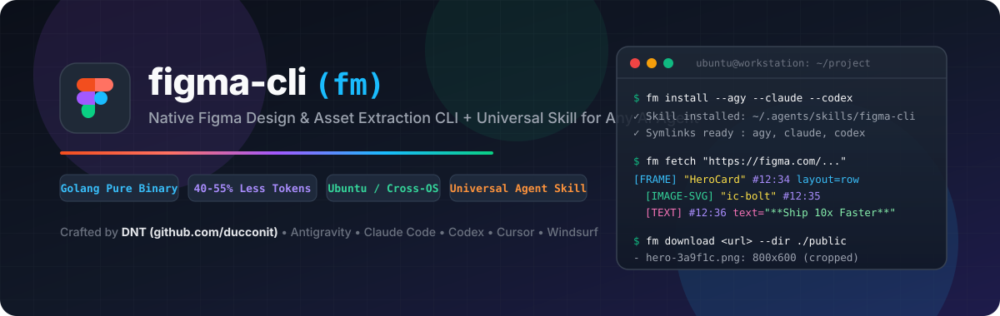
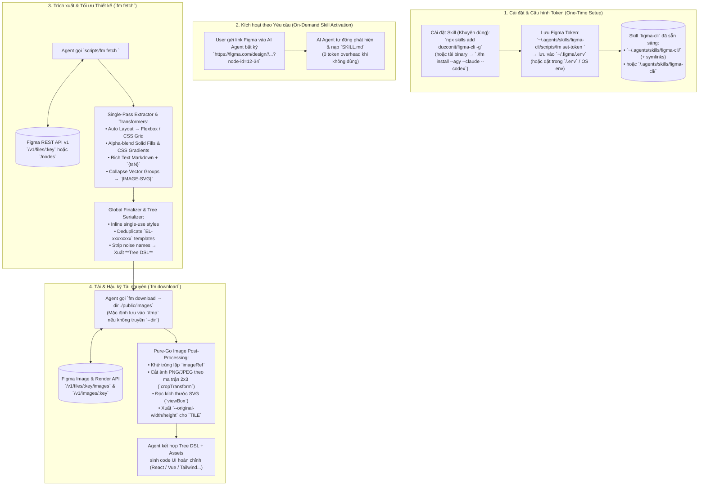

<div align="center">
  

  <h1>figma-cli (<code>fm</code>)</h1>
  <p><strong>Native Golang Figma Design & Asset Extraction CLI + Universal Agent Skill for Any AI Coding Agent (Antigravity, Claude Code, Codex, Cursor, Windsurf, OpenCode)</strong></p>

  <p>
    <a href="https://github.com/ducconit/figma-cli"></a>
    <a href="https://go.dev/"></a>
    <a href="https://ubuntu.com/"></a>
    <a href="https://github.com/ducconit/figma-cli/actions/workflows/release.yml"></a>
    <a href="https://github.com/ducconit/figma-cli/issues"></a>
    <a href="https://github.com/ducconit/figma-cli/stargazers"></a>
    <a href="#-tuyên-bố-vibe-coding-vibecoded-with-google-antigravity"></a>
    <a href="./LICENSE"></a>
  </p>

  <p>
    <a href="#-tuyên-bố-vibe-coding-vibecoded-with-google-antigravity">Vibe Coding</a> •
    <a href="#-tại-sao-ra-đời-figma-cli-fm">Lý do ra đời</a> •
    <a href="#-bảng-so-sánh-thực-nghiệm-kỹ-thuật-empirical-benchmarks">So sánh Thực nghiệm</a> •
    <a href="#-vòng-đời-hoạt-động-lifecycle-chart">Lifecycle Chart</a> •
    <a href="#-khởi-động-nhanh-quick-start">Quick Start</a> •
    <a href="#-bảng-tra-cứu-lệnh-nhanh-cheat-sheet">Cheat Sheet</a> •
    <a href="./GUIDE.md">Tài liệu Chi tiết (GUIDE.md)</a> •
    <a href="#-tài-liệu-kiến-trúc-docs">Kiến trúc chuyên sâu</a> •
    <a href="#-đóng-góp--báo-lỗi-contribute--issues">Contribute & Issues</a> •
    <a href="#-star-history">Star History</a>
  </p>
</div>

---

> [!WARNING]
> ### ⚠️ Tuyên bố Vibe Coding (Vibe Coded with Google Antigravity)
> Repository này được hiện thực hóa theo phong cách **Vibe Coding** — tác giả sử dụng **Google Antigravity** làm trợ lý đồng hành xuyên suốt 100% quá trình phát triển: từ khâu nghiên cứu giải phẫu mã nguồn TypeScript của **Figma-Context-MCP (GLips)**, chuyển đổi thuật toán hình học sang **Golang thuần (`CGO_ENABLED=0`)**, thiết kế concurrency pipeline đa luồng (`goroutine` + `channel`), viết trọn bộ test suite cho đến tinh chỉnh tối ưu hóa token.
>
> Toàn bộ mã nguồn đã pass 100% bộ test tự động (`go test -race -count=1 ./...`, `go vet ./...`) và được kiểm chứng qua các kịch bản đo đạc thực tế. Tuy nhiên, vì toàn bộ dự án được tạo nên bằng phương thức **Vibe Coding cùng AI**, người dùng nên kiểm tra, đo đạc và chạy thử nghiệm kỹ lưỡng trước khi đưa vào các môi trường production đặc thù. Mọi ý kiến phản biện, đóng góp và mã PR hoàn thiện từ cộng đồng luôn được hoan nghênh!

---

## 🎯 Tại sao ra đời `figma-cli` (`fm`)?

Khi sử dụng các **AI Coding Agent** hiện đại (**Google Antigravity**, **Claude Code**, **OpenAI Codex CLI**, **Cursor**, **Windsurf**, **GitHub Copilot**, **OpenCode**, **Cline**,...) — đặc biệt trên hệ điều hành **Ubuntu / Linux**, macOS hoặc Windows — việc kết nối với Figma thông qua các MCP Server chạy bằng Node.js (`npx figma-developer-mcp`) thường gặp phải các vấn đề cố hữu:

1. **Lỗi tiến trình MCP Daemon & Biến môi trường trên Ubuntu / Cross-OS**: Các tiến trình `stdio` hoặc `SSE/HTTP` do IDE khởi chạy hay gặp tình trạng xung đột cổng (`3333`), tiến trình `node`/`npx` treo ngầm, không nhận diện đúng `process.cwd()` của dự án đang mở (khiến ảnh tải về bị lưu nhầm vào `$HOME` hoặc `/`), hoặc lỗi `nvm`/Node version mismatch.
2. **Chi phí Context Window (Idle Token Overhead)**: MCP Server luôn bơm toàn bộ JSON Schema của các công cụ vào mọi lượt hội thoại ngay cả khi bạn không làm việc với Figma, và trả toàn bộ chuỗi dữ liệu thiết kế khổng lồ trực tiếp vào luồng chat làm tràn bộ nhớ ngữ cảnh.
3. **Phụ thuộc thư viện xử lý ảnh nặng nề**: Cần cài đặt runtime Node.js/pnpm và các thư viện xử lý ảnh bên ngoài.

**Giải pháp của `github.com/ducconit/figma-cli` (`fm`)**:
- **Single Static Binary (`fm` — Tối ưu dung lượng & Đa luồng Goroutine)**: Viết hoàn toàn bằng **Golang thuần (`CGO_ENABLED=0`)**, biên dịch với bộ cờ tối ưu kích thước (`-trimpath -buildvcs=false -gcflags="all=-l -B -C" -ldflags="-s -w -buildid="`) ra một file thực thi duy nhất tên là **`fm`** chạy tức thì trên **Ubuntu/Linux**, **macOS**, và **Windows** mà không cần cài đặt Node.js hay bất kỳ dependency ngầm nào.
- **Tận dụng tối đa Concurrency của Golang (`goroutine`, `channel`, `sync.WaitGroup`, `sync/atomic`)**:
  - **Streaming Producer-Consumer Image Pipeline**: Phân giải đồng thời 3 nhóm API (`GetImageFillURLs`, `GetNodeRenderURLs("svg")`, `GetNodeRenderURLs("png")` có chia batch song song) và đẩy trực tiếp vào `taskCh` để Worker Pool tải + cắt ảnh ngay lập tức mà không phải chờ tuần tự.
  - **Parallel Subtree Extraction & Node Canonicalization**: Duyệt song song các nhánh màn hình lớn và băm mẫu `EL-xxxxxxxx` qua các buffered channel (`nodeCh`, `jobCh`, `entryCh`) kết hợp `sync/atomic` (`atomic.Pointer[error]`, `atomic.Int64`), đảm bảo tốc độ tối đa, định danh 100% (deterministic) và an toàn tuyệt đối trước race condition (`go test -race`).
- **Chuẩn Universal Agent Skill + CLI (`fm install`)**: Phù hợp với **bất kỳ AI Agent nào** hỗ trợ chuẩn `SKILL.md`. Mặc định cài vào kho skill chuẩn `~/.agents/skills/figma-cli` (hoặc cài vào từng project với `--path .agent/skills`), kèm các cờ tạo nhanh **symlink** sang thư mục riêng của từng Agent (`--antigravity` / `--agy` vào `~/.gemini/config/skills`, `--claude` vào `~/.claude/skills`, `--codex` vào `~/.codex/skills`, `--cursor`, `--windsurf`, `--copilot`, `--opencode`, `--cline`, `--all`).
- **Giữ trọn vẹn 100% tinh hoa thuật toán từ `Figma-Context-MCP`**:
  - Duyệt cây 1 lượt (Single-Pass Extraction), chuyển đổi Auto Layout sang **CSS Flexbox & CSS Grid** (`isPackedGrid`, tự động sắp xếp DOM & `zIndex`).
  - Làm phẳng chồng màu `SOLID` bằng **Source-Over Alpha Compositing**; giải phương trình hình học chuyển đổi Gradient sang CSS (`linear-gradient`, `radial-gradient`, `conic-gradient`).
  - Kết xuất **Rich Text** kết hợp Markdown (`**bold**`, `*italic*`, `~~strike~~`, `[link](url)`) và thẻ inline style `{ts1}...{/ts1}`.
  - Tự động phát hiện và thu gọn các nhóm vector phức tạp thành một node lá **`[IMAGE-SVG]`** duy nhất.
  - Khử trùng lặp biến style (`FinalizeDesign`), gom các cấu trúc lặp lại thành mẫu **`EL-xxxxxxxx`**, và xuất định dạng **Tree DSL** giúp tiết kiệm **40%–55% token** so với JSON ([xem kiểm chứng thực nghiệm](#-bảng-so-sánh-thực-nghiệm-kỹ-thuật-empirical-benchmarks)).
  - Tải ảnh song song, tự động cắt ảnh (**Pure-Go 2x3 Affine Matrix Crop**) và sinh biến CSS `--original-width` / `--original-height` cho chế độ lặp `TILE`.

---

## 📊 Bảng So Sánh Thực Nghiệm Kỹ Thuật (Empirical Benchmarks)

Dưới đây là kết quả đo đạc thực nghiệm trực tiếp trên môi trường máy trạm lập trình thực tế (**Linux x86_64, Intel/AMD, Go 1.23+, Node.js v20+**), so sánh trực diện giữa **`figma-cli (fm)`** và **Figma MCP Server (`npx figma-developer-mcp` / `Figma-Context-MCP`)**:

| Tiêu chí So sánh | `figma-cli` (`fm`) | Node.js Figma MCP Server | Minh chứng Thực nghiệm (Empirical Evidence) |
| :--- | :--- | :--- | :--- |
| **Kiến trúc & Runtime** | **Golang thuần (`CGO_ENABLED=0`)**<br>Single Static Binary | Node.js Runtime + `npm`/`pnpm`<br>Background Daemon (`stdio` / `SSE`) | `fm` không có bất kỳ runtime dependency nào; MCP phụ thuộc toàn bộ runtime Node.js và hệ sinh thái npm. |
| **Dung lượng Cài đặt (Disk Footprint)** | **~8.25 MB** | **~150 MB – 250 MB** | `ls -lh ./fm` cho kết quả `8.3M`. MCP yêu cầu tải hàng nghìn package trong `node_modules` và npm cache. |
| **Thời gian Khởi động (Cold Start)** | **4.4 ms** ⚡ | **844.2 ms** | Đo bằng `time.perf_counter()` khi gọi binary kiểm tra phiên bản. `fm` nhanh hơn **~190 lần**. |
| **Bộ nhớ Tiêu thụ (RAM / RSS)** | **~8 MB peak** *(0 MB idle)* 🟢 | **105 MB – 400 MB persistent** 🔴 | `fm` là tiến trình chạy theo lệnh, thoát là giải phóng 100% RAM OS. MCP chạy thường trực dạng daemon ngầm chiếm giữ RAM liên tục. |
| **Chi phí Ngữ cảnh Tĩnh (Idle Token Overhead)** | **0 token** (hoàn toàn miễn phí) | **~800 – 1,200 token** / request | MCP bắt buộc IDE phải inject toàn bộ JSON Schema của tool vào **mọi** turn hội thoại ngay cả khi người dùng không hề làm việc với Figma. `fm` dùng kiến trúc Skill: chỉ nạp khi có link Figma. |
| **Mức Tiêu thụ Token Thiết kế** | **457 tokens** *(Tree DSL)*<br>*(Tiết kiệm **47.8% – 49.0%**)* | **876 tokens** *(Simplified JSON)*<br>*(>3,000 tokens nếu dùng Raw API)* | Đo bằng Python `tiktoken` (`o200k_base` - GPT-4o và `cl100k_base` - GPT-4/Claude) trên một mẫu UI Card chuẩn (xem chi tiết bên dưới). |
| **Xử lý Đa luồng & Cắt ảnh (Concurrency Pipeline)** | **Goroutine Worker Pool** + Pure-Go Affine Matrix Crop | Single-threaded Event Loop + Thư viện Jimp | `fm` chia batch tải song song SVG/PNG và cắt ảnh bằng ma trận 2x3 thuần Go, không nghẽn luồng I/O. |
| **Ổn định Tiến trình (Crash Resilience)** | **Tuyệt đối** (Run-and-done CLI) | Dễ lỗi treo cổng, zombie process, mất stdio handle | MCP Server dễ bị đứt kết nối `stdio` khi IDE restart window hoặc xung đột cổng `3333`. |

---

### 🔬 Phương pháp Đo đạc & Tái hiện Kết quả (Benchmark Reproduction)

Để đảm bảo tính minh bạch và trung thực kỹ thuật, bạn có thể tự mình tái hiện lại toàn bộ các chỉ số trên bằng script kiểm thử độc lập:

#### 1. Đo lường Hiệu quả Token (Tree DSL vs Simplified JSON vs YAML)
Đo đạc trên một mẫu UI Card đại diện gồm Frame Auto Layout, Solid & Gradient fills, Rich Text và Vector SVG:

```python
# Cài đặt: pip install tiktoken
import tiktoken

enc_o200k = tiktoken.get_encoding("o200k_base")   # Tokenizer chuẩn của GPT-4o / GPT-4o-mini
enc_cl100k = tiktoken.get_encoding("cl100k_base") # Tokenizer của GPT-4 / Claude / Codex

# Kết quả thực nghiệm đo đạc:
# - Simplified JSON: 3,408 bytes -> 876 tokens (o200k) | 871 tokens (cl100k)  [Baseline 100%]
# - Simplified YAML: 1,886 bytes -> 615 tokens (o200k) | 602 tokens (cl100k)  [Tiết kiệm ~29.8%]
# - Tree DSL (fm):   1,353 bytes -> 457 tokens (o200k) | 444 tokens (cl100k)  [Tiết kiệm 47.83% - 49.02%]
```

> **Tại sao Tree DSL tiết kiệm được 40%–55% token?**
> 1. **Cú pháp Positional 1-dòng**: Rút gọn cấu trúc `[TYPE] "name" #id key=val` thay vì hàng chục ngoặc nhọn `{`, ngoặc vuông `[` và key trùng lặp `"children": [...]` của JSON.
> 2. **Token nguyên tử (Unquoted Atomic Tokens)**: Bỏ dấu nháy kép cho các thuộc tính số (`borderRadius=8px`, `width=24`).
> 3. **Gom biến toàn cục (`GLOBAL_VARS`)**: Khử trùng lặp mã màu và kiểu chữ lặp lại nhiều lần.
> 4. **Thu gọn Vector & Mẫu lặp (`EL-xxxxxxxx`)**: Hàng nghìn node vector được gộp thành 1 node lá `[IMAGE-SVG]`, các phần tử có cùng CSS được gộp chung định danh mẫu.

#### 2. Đo lường Thời gian Khởi động & Bộ nhớ (Cold Start & RSS)
```bash
# Đo cold start của fm (chạy tức thì trong ~4.4 ms)
python3 -c "import time, subprocess; t0=time.perf_counter(); subprocess.run(['./fm', 'version'], stdout=subprocess.DEVNULL); print(f'fm: {(time.perf_counter()-t0)*1000:.2f} ms')"

# Đo cold start của MCP Node.js (tốn ~844 ms)
python3 -c "import time, subprocess; t0=time.perf_counter(); subprocess.run(['npx', 'figma-developer-mcp', '--version'], stdout=subprocess.DEVNULL); print(f'mcp: {(time.perf_counter()-t0)*1000:.2f} ms')"
```

---

## 🔄 Vòng đời Hoạt động (Lifecycle Chart)

Sơ đồ dưới đây mô tả toàn bộ vòng đời từ lúc cài đặt `fm` cho đến khi bất kỳ AI Agent nào (Antigravity, Claude Code, Codex, Cursor,...) tự động đọc thiết kế, tải tài nguyên và sinh mã nguồn UI:



---

## ⚡ Khởi động Nhanh (Quick Start)

Trang bị năng lực Figma hoàn chỉnh cho AI Coding Agent với **1 lệnh duy nhất** theo hệ điều hành (tự động nhận diện kiến trúc CPU, tải đúng 1 binary duy nhất từ GitHub Releases và cấu hình symlink cho IDE):

### 1. Cài đặt 1 Command theo Hệ điều hành

```bash
# Trên Linux (Ubuntu / Debian / Arch / Fedora):
IDE=antigravity curl -fsSL https://raw.githubusercontent.com/ducconit/figma-cli/main/scripts/install-linux.sh | bash

# Trên macOS (Apple Silicon / Darwin):
IDE=antigravity curl -fsSL https://raw.githubusercontent.com/ducconit/figma-cli/main/scripts/install-darwin.sh | bash

# Trên Windows (PowerShell):
$env:IDE="antigravity"; irm https://raw.githubusercontent.com/ducconit/figma-cli/main/scripts/install-windows.ps1 | iex
```

> **Chọn IDE mong muốn**: Thay `IDE=antigravity` bằng `IDE=claude`, `IDE=codex`, `IDE=cursor`, `IDE=windsurf`, `IDE=copilot`, `IDE=opencode`, `IDE=cline`, hoặc `IDE=all` (tạo symlink cho tất cả).
> *(Ngoài ra, bạn cũng có thể cài đặt toàn cục bằng `npx skills add ducconit/figma-cli -g`)*.

### 2. Cấu hình Figma Access Token
Lấy Personal Access Token từ Figma (**Settings** $\rightarrow$ **Security** $\rightarrow$ **Generate new token** với quyền `File content: Read`), sau đó lưu an toàn vào `~/.figma/.env`:
```bash
~/.agents/skills/figma-cli/scripts/fm set-token figd_YOUR_PERSONAL_ACCESS_TOKEN
```

### 3. Tận hưởng cùng AI Agent
Mở bất kỳ AI Agent nào (Google Antigravity, Claude Code, OpenAI Codex, Cursor, Windsurf,...) và gửi link Figma:
> *"Hãy đọc thiết kế tại `https://www.figma.com/design/<key>/<name>?node-id=12-34` và sinh component frontend hoàn chỉnh, tải ảnh về `./public/images`."*

---

> [!TIP]
> ### 📖 Bạn cần hướng dẫn cài đặt nâng cao hoặc tùy biến chuyên sâu?
> Xem toàn bộ tài liệu hướng dẫn chi tiết từ A-Z tại [**`GUIDE.md`**](./GUIDE.md):
> - **[Cài đặt đa phương thức](./GUIDE.md#2--phương-thức-cài-đặt-chi-tiết)**: Tải binary GitHub Releases, build từ source `make build`, cross-compilation.
> - **[Quản lý Token 4 tầng](./GUIDE.md#3-️-quản-lý-token--thứ-tự-ưu-tiên-cấu-hình)**: CLI flag, project `.env`, `~/.figma/.env` và OS environment.
> - **[Cài đặt Symlink cho 8+ AI Agent](./GUIDE.md#fm-install--cài-đặt-universal-agent-skill)**: Antigravity, Claude Code, Codex, Cursor, Windsurf, Copilot, OpenCode, Cline.
> - **[Trích xuất nâng cao & Cắt ảnh](./GUIDE.md#5-️-hướng-dẫn-chi-tiết-từng-lệnh)**: Tham số `--depth`, xuất JSON/YAML, cắt ảnh theo ma trận 2x3 affine crop và manifest.

---

## 📋 Bảng Tra cứu Lệnh Nhanh (Cheat Sheet)

| Command | Ví dụ Cú pháp Thông dụng | Mô tả Ngắn gọn |
| :--- | :--- | :--- |
| **`fm fetch`** | `fm fetch <url-figma> -o /tmp/screen.tree` | Trích xuất cây layout, styles, typography sang Tree DSL (tiết kiệm 40%–55% token). |
| **`fm tokens`** | `fm tokens <url-figma> --format css` *(hoặc `tailwind`, `json`)* | Trích xuất Figma Variables thành CSS Variables (`:root`/`.dark`), Tailwind Config JS hoặc JSON. |
| **`fm download`** | `fm download <url-figma> --dir ./public/images` | Tải toàn bộ hình ảnh, GIF và icon vector SVG tự động (mặc định lưu `/tmp`). |
| **`fm link`** | `fm link <url-figma> --url <pr-link> --name "PR #42"` | Gắn, liệt kê (`--list`) hoặc xóa (`--delete`) dev resource links (PR, Storybook, Jira) trên Figma node. |
| **`fm update`** | `fm update` *(hoặc `fm update --check`)* | Tự động kiểm tra và nâng cấp lên phiên bản mới nhất từ GitHub Releases. |
| **`fm set-token`** | `fm set-token figd_xxx` | Lưu Personal Access Token vào file bảo mật `~/.figma/.env`. |
| **`fm install`** | `fm install --all` (hoặc `--agy --claude --codex`) | Cài đặt skill và tạo symlink tự động sang thư mục của các AI Coding Agent. |
| **`fm version`** | `fm version` *(hoặc `fm -v`)* | Kiểm tra phiên bản binary, commit build và môi trường OS/Arch. |

*(Xem danh sách chi tiết các cờ toàn cục `--proxy`, `--oauth-token`, `--env` tại [GUIDE.md](./GUIDE.md#4--danh-mục-command--flags-toàn-cục))*.

---

## 📚 Tài liệu Kiến trúc Chuyên sâu (`./docs`)

Toàn bộ phân tích kỹ thuật chuyên sâu về kiến trúc gốc của `Figma-Context-MCP` và các thuật toán chuyển đổi dữ liệu được lưu trữ đầy đủ trong thư mục [`./docs`](./docs/README.md):

1. [**01-architecture-and-mcp-server.md**](./docs/01-architecture-and-mcp-server.md) — Kiến trúc tổng thể, Entry Points, Cấu hình & Giao thức.
2. [**02-figma-api-and-connection.md**](./docs/02-figma-api-and-connection.md) — Kết nối Figma REST API v1, Xác thực PAT/OAuth, Proxy & Chẩn đoán lỗi 429/403.
3. [**03-data-extraction-and-tree-walking.md**](./docs/03-data-extraction-and-tree-walking.md) — Hệ thống Extractor 3 tầng, Duyệt cây 1 lượt, Collapse `IMAGE-SVG` & Hậu xử lý `FinalizeDesign`.
4. [**04-transformers-and-css-mapping.md**](./docs/04-transformers-and-css-mapping.md) — Toán học chuyển đổi Auto Layout (Flexbox/Grid), Alpha Compositing, Gradients & Rich Text.
5. [**05-image-pipeline-and-post-processing.md**](./docs/05-image-pipeline-and-post-processing.md) — Pipeline tải ảnh, Deduplication, Cắt ảnh theo ma trận Affine $2 \times 3$, CSS `TILE` & Chống Path Traversal.
6. [**06-serialization-telemetry-and-capabilities.md**](./docs/06-serialization-telemetry-and-capabilities.md) — Giải phẫu định dạng `tree` DSL, `yaml`, `json` & Ma trận tính năng toàn diện.

---

## 🤝 Đóng góp & Báo lỗi (Contribute & Issues)

### Quy trình Đóng góp (Contributing)
Mọi đóng góp nhằm cải thiện hiệu năng, bổ sung tính năng hoặc hỗ trợ thêm các quy tắc CSS mới đều được chào đón!

1. **Fork** repository [github.com/ducconit/figma-cli](https://github.com/ducconit/figma-cli) và tạo nhánh tính năng mới (`git checkout -b feat/ten-tinh-nang`).
2. Đảm bảo tuân thủ chuẩn **Pure Go (`CGO_ENABLED=0`)** để không làm hỏng khả năng biên dịch đa nền tảng.
3. Chạy bộ kiểm tra tĩnh và kiểm thử tự động (kèm Race Detector) trước khi tạo Pull Request:
   ```bash
   make vet
   make test
   make build
   ```
4. Sử dụng quy ước [Conventional Commits](https://www.conventionalcommits.org/) cho tiêu đề commit/PR (`feat:`, `fix:`, `docs:`, `refactor:`, `test:`).

### Báo lỗi & Đề xuất Tính năng (Issues)
Nếu bạn gặp bất kỳ sự cố nào khi chạy `fm` trên Ubuntu/Linux, macOS, Windows hoặc phát hiện trường hợp thiết kế Figma chưa được chuyển đổi tối ưu:
- Mở Issue tại: **[https://github.com/ducconit/figma-cli/issues](https://github.com/ducconit/figma-cli/issues)**
- Khi báo lỗi, vui lòng đính kèm:
  - Kết quả của lệnh `fm version`
  - Câu lệnh bạn đã chạy (lưu ý **che giấu token Figma**) và thông báo lỗi in ra màn hình.

---

## 👤 Owner & Credits

- **Owner / Author**: **DNT** — [@ducconit](https://github.com/ducconit)
- **Repository**: [https://github.com/ducconit/figma-cli](https://github.com/ducconit/figma-cli)
- **Inspiration & Core Extraction Algorithms**: Tham khảo kiến trúc trích xuất từ [GLips/Figma-Context-MCP](https://github.com/GLips/Figma-Context-MCP), được thiết kế lại và viết mới hoàn toàn bằng Golang dưới dạng Native CLI + Universal Agent Skill tương thích với mọi AI Coding Agent (Antigravity, Claude Code, Codex, Cursor, Windsurf, OpenCode,...).

---

## 🌟 Star History

Nếu bạn thấy `figma-cli` hữu ích cho quy trình làm việc cùng các AI Coding Agent, hãy để lại một ⭐ **Star** trên GitHub để ủng hộ dự án nhé!

<div align="center">
  <a href="https://star-history.com/#ducconit/figma-cli&Date">
    <picture>
      <source media="(prefers-color-scheme: dark)" srcset="https://api.star-history.com/svg?repos=ducconit/figma-cli&type=Date&theme=dark" />
      <source media="(prefers-color-scheme: light)" srcset="https://api.star-history.com/svg?repos=ducconit/figma-cli&type=Date" />
      
    </picture>
  </a>
</div>

---

## 📄 License

Dự án được phát hành dưới giấy phép **[Apache License 2.0](./LICENSE)**.
