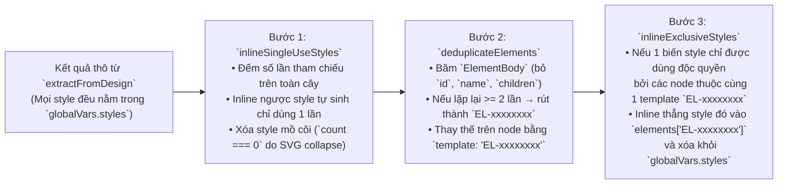

# 03. Hệ thống Extractor, Duyệt Cây 1 Lượt & Tối ưu Hóa Toàn Cục (`Figma-Context-MCP`)

Tài liệu này phân tích chi tiết kiến trúc **Single-Pass Composable Extraction** kết hợp với **Post-Walk Global Finalization** trong thư mục `src/extractors/` của `Figma-Context-MCP`. Đây là trái tim của hệ thống giúp nén một payload JSON thô hàng chục megabyte từ Figma REST API thành một cấu trúc ngữ nghĩa siêu gọn cho Context Window của LLM.

---

## 1. Kiến trúc 3 Tầng của Hệ thống Extractor (`src/extractors/`)

Hệ thống trích xuất được chia thành 3 tầng tách biệt rõ ràng (`src/extractors/README.md`, `src/extractors/index.ts`):

1. **Tầng Chiến lược (Strategy Layer — `src/extractors/design-extractor.ts`, `built-in.ts`)**:
   - Định nghĩa *những thông tin nào* cần lấy thông qua việc ghép nối mảng các hàm `ExtractorFn` và cấu hình `TraversalOptions` (`maxDepth`, `nodeFilter`, `afterChildren`).
   - Cung cấp 5 tổ hợp dựng sẵn (presets):
     - `allExtractors = [layoutExtractor, textExtractor, visualsExtractor, componentExtractor]` (mặc định cho MCP Server)
     - `layoutAndText = [layoutExtractor, textExtractor]`
     - `contentOnly = [textExtractor]`
     - `visualsOnly = [visualsExtractor]`
     - `layoutOnly = [layoutExtractor]`
2. **Tầng Duyệt cây (Traversal Layer — `src/extractors/node-walker.ts`)**:
   - Duyệt cây tài liệu Figma **chỉ trong 1 lượt duy nhất (single-pass)** thông qua hàm `extractFromDesign` và `processNodeWithExtractors`.
   - Chịu trách nhiệm lọc node ẩn, kiểm soát độ sâu `maxDepth`, sắp xếp lại thứ tự phần tử con trong CSS Grid, nhường event loop định kỳ (`maybeYield`), và kích hoạt callback hậu xử lý từ dưới lên (`afterChildren`).
3. **Tầng Trích xuất & Tối ưu Toàn cục (Extraction & Finalization Layer — `src/extractors/built-in.ts`, `finalize.ts`)**:
   - Các `ExtractorFn` đọc từng `FigmaDocumentNode`, gọi sang hệ thống Transformers (`src/transformers/`) và ghi kết quả vào `SimplifiedNode` + `GlobalVars`.
   - Sau khi duyệt xong toàn bộ cây, `finalizeDesign` (`src/extractors/finalize.ts`) thực hiện phân tích tần suất toàn cục để inline các biến chỉ dùng 1 lần và gom các cấu trúc node lặp lại thành bảng mẫu `elements` (`EL-xxxxxxxx`).

---

## 2. Các Kiểu Dữ liệu Cốt lõi (`src/extractors/types.ts`)

| Kiểu dữ liệu | Cấu trúc & Ý nghĩa kỹ thuật |
| :--- | :--- |
| **`SimplifiedDesign`** | Kết quả hoàn chỉnh sau khi rút gọn:<br>• `name: string` — Tên file/thiết kế Figma<br>• `nodes: SimplifiedNode[]` — Cây các node gốc đã rút gọn<br>• `components: Record<string, SimplifiedComponentDefinition>` — Định nghĩa các Component<br>• `componentSets: Record<string, SimplifiedComponentSetDefinition>` — Định nghĩa các Variant Set<br>• `globalVars: GlobalVars` — Bảng tra cứu biến style dùng chung (`{ styles: Record<string, StyleTypes> }`)<br>• `elements: Record<string, ElementBody>` — Bảng tra cứu thân phần tử (`EL-xxxxxxxx`) cho các node có cấu trúc lặp lại từ 2 lần trở lên. |
| **`SimplifiedNode`** | Đại diện cho một phần tử thiết kế trên cây:<br>• Định danh & Cấu trúc: `id: string`, `name?: string`, `type?: string`, `template?: string` (tham chiếu tới `elements`), `children?: SimplifiedNode[]`<br>• Layout: `layout?: string \| SimplifiedLayout`<br>• Typography: `text?: string`, `textStyle?: string \| SimplifiedTextStyle`, `boldWeight?: number`<br>• Visuals: `fills?: string \| SimplifiedFill[]`, `strokes?: string \| SimplifiedFill[]`, `strokeWeight?: string`, `strokeWeights?: string`, `strokeDashes?: number[]`, `strokeAlign?: "CENTER" \| "OUTSIDE"`, `effects?: string \| SimplifiedEffects`, `opacity?: number`, `borderRadius?: string`<br>• Component: `componentId?: string`, `componentProperties?: Record<string, boolean \| string>`, `componentPropertyReferences?: Record<string, string>` |
| **`ElementBody`** | `Omit<SimplifiedNode, "id" \| "name" \| "children" \| "template">`. Chứa toàn bộ phần "thân" (bao gồm cả `type`, `layout`, `fills`, `textStyle`, ...) của một node, tách rời khỏi định danh cá별 (`id`, `name`) và danh sách con (`children`) để có thể khử trùng lặp giữa các node anh em/cùng mẫu. |
| **`TraversalContext`** | Ngữ cảnh truyền xuống mỗi bước đệ quy khi duyệt cây:<br>• `globalVars: GlobalVars` & `extraStyles?: Record<string, Style>`<br>• `currentDepth: number` & `parent?: FigmaDocumentNode`<br>• `insideComponentDefinition?: boolean` — Cờ đánh dấu đang duyệt bên trong một `COMPONENT` hoặc `COMPONENT_SET`<br>• `traversalState: TraversalState` (`componentPropertyDefinitions`, `tsCounter`, `namedStyleKeys`)<br>• `nodeCounter: NodeCounter` (`{ count: number }`). |

---

## 3. Luồng `simplifyRawFigmaObject` & Tách Metadata (`src/extractors/design-extractor.ts`)

Hàm [`simplifyRawFigmaObject(apiResponse, nodeExtractors, options)`](file:///tmp/Figma-Context-MCP/src/extractors/design-extractor.ts#L18-L54) xử lý cả hai loại phản hồi từ Figma REST API (`GetFileResponse` từ `/v1/files/:key` và `GetFileNodesResponse` từ `/v1/files/:key/nodes`):

```mermaid
flowchart TD
    Raw["`apiResponse` (`GetFileResponse | GetFileNodesResponse`)"] --> Parse["`parseAPIResponse(apiResponse)`"]
    Parse --> CheckType{"`'nodes' in data`?"}
    
    CheckType -- "Có (`GetFileNodesResponse`)" --> NodeBranch["Lấy entry đầu tiên trong `data.nodes`\n• Nếu `nodeData === null` → ném lỗi `not_found`\n• Gom `nodeData.components`, `componentSets`, `styles`\n• `rawNodes = [nodeData.document]`"]
    CheckType -- "Không (`GetFileResponse`)" --> FileBranch["Lấy trực tiếp từ cấp root:\n• `data.components`, `data.componentSets`, `data.styles`\n• `rawNodes = data.document.children` (Các Canvas/Page)"]
    
    NodeBranch & FileBranch --> Walk["`extractFromDesign(rawNodes, nodeExtractors, options, { styles: {} }, extraStyles)`"]
    Walk --> Finalize["`finalizeDesign(extractedNodes, walkedGlobalVars, traversalState.namedStyleKeys)`"]
    Finalize --> MergeComp["Ghép `traversalState.componentPropertyDefinitions` vào `components` & `componentSets`"]
    MergeComp --> Out["Trả về `SimplifiedDesign`"]
```

- **Chẩn đoán lỗi `nodeData === null` (`src/extractors/design-extractor.ts:68-80`)**:
  Khi người dùng truyền một `nodeId` vào `/v1/files/:key/nodes` nhưng Figma trả về `nodes: { "12:34": null }`, hàm ném lỗi kèm tag `{ category: "not_found" }` và giải thích rõ 3 nguyên nhân thực tế:
  1. Đường dẫn thuộc loại không được hỗ trợ (`/proto/`, `/figjam/`, `/slides/`).
  2. Node nằm trong một nhánh (branch) nên cần dùng `fileKey` của branch đó.
  3. Node đã bị xóa khỏi file.

---

## 4. Thuật toán Duyệt Cây `extractFromDesign` (`src/extractors/node-walker.ts`)

### 4.1. Nhường Event Loop Định kỳ (`maybeYield`)
Trong các file thiết kế lớn có từ 20.000 đến 100.000 nodes, việc duyệt đệ quy đồng bộ liên tục sẽ khóa cứng (block) event loop của Node.js trong nhiều giây, làm ngắt nhịp tim progress heartbeat và chặn các HTTP request khác.
Hàm `maybeYield(counter: NodeCounter)` (`src/extractors/node-walker.ts:18-25`) giải quyết bằng cách:
```typescript
const YIELD_INTERVAL = 100;

async function maybeYield(counter: NodeCounter): Promise<void> {
  if (counter.count % YIELD_INTERVAL === 0) {
    await new Promise<void>((resolve) => setImmediate(resolve));
  }
}
```
Cứ mỗi **100 nodes** được xử lý, trình duyệt cây tạm nhường quyền điều khiển qua `setImmediate` để Node.js gửi các gói tin `notifications/progress` (kèm số đếm `counter.count` cập nhật trực tiếp) và phục vụ các kết nối song song.

---

### 4.2. Điều kiện Lọc Node & Cơ chế "Giải cứu" Node Ẩn trong Component (`shouldProcessNode`)

Hàm [`shouldProcessNode(node, context, options)`](file:///tmp/Figma-Context-MCP/src/extractors/node-walker.ts#L144-L166) quyết định một node có được đưa vào kết quả hay bị cắt bỏ:

1. **Kiểm tra hiển thị (`isVisible(node)`)**:
   - Mặc định, mọi layer bị tắt con mắt ẩn trong Figma (`node.visible === false`) sẽ bị loại bỏ ngay lập tức (không duyệt tiếp xuống con của nó).
2. **Ngoại lệ Tinh tế: Giải cứu Node Ẩn được Điều khiển bởi Boolean Property (`insideComponentDefinition`)**:
   ```typescript
   if (!isVisible(node)) {
     const hasVisibleRef =
       "componentPropertyReferences" in node &&
       node.componentPropertyReferences &&
       typeof node.componentPropertyReferences === "object" &&
       "visible" in node.componentPropertyReferences;
     if (!(hasVisibleRef && context.insideComponentDefinition)) {
       return false;
     }
   }
   ```
   - **Tại sao cần ngoại lệ này?** Khi Designer thiết kế một `COMPONENT` hoặc `COMPONENT_SET` (ví dụ: Component `Button` có một icon phụ hoặc badge giảm giá), họ thường đặt giá trị mặc định của thuộc tính boolean `Show Badge` là `false`. Lúc này trong dữ liệu gốc của `COMPONENT`, layer Badge có `visible: false`, nhưng có `componentPropertyReferences: { visible: "Show Badge#12:0" }`.
   - Nếu đang duyệt bên trong định nghĩa của `COMPONENT` / `COMPONENT_SET` (`context.insideComponentDefinition === true`), trình duyệt cây **giữ lại layer ẩn này** để LLM khi viết code component biết rằng có một phần tử tùy chọn được điều khiển bởi prop `Show Badge`!
   - Ngược lại, khi duyệt vào bên trong một **`INSTANCE`** (`insideComponentDefinition` được đặt lại về `false` tại dòng 99–104), giá trị prop trên instance đó đã là quyết định cuối cùng: nếu trên instance đó layer vẫn ẩn (`visible: false`) thì nó sẽ bị loại bỏ hoàn toàn để không làm rác kết quả.

---

### 4.3. Sắp xếp lại Thứ tự Con trong CSS Grid (`computeGridChildOrder`)
Khi một node cha sử dụng Auto Layout dạng lưới (`layoutMode === "GRID"`), Figma lưu mảng `node.children` theo thứ tự chồng lớp Z-order (layer nào vẽ sau nằm cuối mảng) chứ không theo thứ tự dòng/cột của lưới.
Tại `src/extractors/node-walker.ts:116-117`, trước khi đệ quy xuống các con, walker gọi `computeGridChildOrder(node)` để sắp xếp lại các phần tử con in-flow theo thứ tự `gridRowAnchorIndex` tăng dần $\rightarrow$ `gridColumnAnchorIndex` tăng dần. Nhờ đó, mảng `result.children` xuất ra luôn khớp với luồng chảy tự nhiên của CSS Grid trên DOM.

---

### 4.4. Tự động Phát hiện và Gộp Nhóm Vector thành `"IMAGE-SVG"` (`collapseSvgContainers`)

Một trong những tính năng quan trọng nhất giúp `Figma-Context-MCP` tiết kiệm hàng chục nghìn token cho mỗi màn hình thiết kế là cơ chế **Vector Container Collapsing** (`src/extractors/node-walker.ts:85-89` và `src/extractors/built-in.ts:352-437`).

#### Vấn đề Thực tế:
Một icon minh họa nhỏ trong Figma (như logo, icon thông báo, hình trang trí) thường là một `FRAME`, `GROUP`, hoặc `INSTANCE` chứa bên trong từ 5 đến 50 node `VECTOR`, `BOOLEAN_OPERATION`, `ELLIPSE`, `LINE`, `RECTANGLE` con. Nếu giữ nguyên toàn bộ cây con này, LLM sẽ nhận hàng trăm dòng tọa độ/màu sắc vô nghĩa (vì không có dữ liệu đường cong Béier `vectorPaths`) và cố gắng dựng lại icon bằng các thẻ `<div>` chồng chéo rất xấu.

#### Thuật toán Giải quyết 2 Giai đoạn (Bottom-Up):
1. **Giai đoạn 1 (Tại mỗi Node lá — `node-walker.ts:88`)**:
   - Mọi node có `node.type === "VECTOR"` ngay khi khởi tạo được đổi `result.type = "IMAGE-SVG"`.
2. **Giai đoạn 2 (Bottom-Up qua hook `afterChildren` — `collapseSvgContainers` trong `built-in.ts:400-418`)**:
   - Sau khi toàn bộ `children` của một node cha đã được xử lý đệ quy từ dưới lên, hàm `collapseSvgContainers(node, result, children)` kiểm tra **4 điều kiện**:
     1. **Kiểu của node cha thuộc tập `COLLAPSIBLE_CONTAINER_TYPES`**:
        `"FRAME"`, `"GROUP"`, `"INSTANCE"`, hoặc `"BOOLEAN_OPERATION"`.
     2. **Tất cả các con trực tiếp đã rút gọn đều thuộc tập `SVG_ELIGIBLE_TYPES`**:
        `"IMAGE-SVG"`, `"BOOLEAN_OPERATION"`, `"STAR"`, `"LINE"`, `"ELLIPSE"`, `"REGULAR_POLYGON"`, `"RECTANGLE"`.
        *(Lưu ý: vì chạy từ dưới lên, một nhóm vector con ở tầng sâu sau khi được gộp thành `"IMAGE-SVG"` sẽ giúp container cha của nó ở tầng trên tiếp tục thỏa mãn điều kiện 100% con là `SVG_ELIGIBLE_TYPES`!).*
     3. **Không chứa ảnh Bitmap (`!hasImageFillOnSelfOrDirectChildren(node)`)**:
        Kiểm tra bản thân `node` và các con trực tiếp không có fill nào mang `type === "IMAGE"` (tránh việc gộp nhầm một khung ảnh avatar hình tròn `ELLIPSE` có chứa ảnh chụp người dùng thành file vector SVG).
     4. **Bảo vệ bố cục Auto-Layout (`!hasAutoLayout(node) || children.length >= 10`)**:
        - Nếu container dùng Auto-Layout (Flex/Grid) và có **ít hơn 10 phần tử con** (`SVG_COLLAPSE_AUTOLAYOUT_THRESHOLD = 10`), hệ thống **KHÔNG gộp** vì đây thường là các thành phần UI có cấu trúc bố cục cần code bằng CSS (như biểu đồ cột bar chart, thanh tiến trình, lưới bảng màu).
        - Nếu container **không dùng Auto-Layout** (như icon, logo) **HOẶC** dùng Auto-Layout nhưng có **từ 10 phần tử hình học trở lên** (như nền lưới chấm bi trang trí lặp lại hàng chục hình tròn), hàm lập tức biến container cha thành một node lá duy nhất:
          ```typescript
          result.type = "IMAGE-SVG";
          return []; // Cắt bỏ toàn bộ mảng children!
          ```
   - **Kết quả**: Toàn bộ nhánh cây phức tạp của icon được thay bằng **1 dòng duy nhất** `[IMAGE-SVG] "ic-bell" #12:34 ...`. Khi LLM thấy `type: "IMAGE-SVG"`, nó chỉ cần gọi tool `download_figma_images` với `nodeId: "12:34"` và `fileName: "ic-bell.svg"` để lấy file SVG chuẩn từ Figma.

---

## 5. Quản lý Biến Style: Content-Addressed Hashing vs Named Styles (`src/extractors/built-in.ts`)

Trong quá trình chạy 4 built-in extractors (`layoutExtractor`, `textExtractor`, `visualsExtractor`, `componentExtractor`), mọi đối tượng style được đăng ký vào `context.globalVars.styles` thông qua 3 cơ chế:

### 5.1. Biến Tự sinh Định danh theo Nội dung (`findOrCreateVar`)
Hàm [`findOrCreateVar(globalVars, value, prefix)`](file:///tmp/Figma-Context-MCP/src/extractors/built-in.ts#L61-L88) tạo mã biến cho các style không có tên trong Design System:
1. Chuẩn hóa đối tượng `value` thành chuỗi JSON bất biến thứ tự khóa qua `stableStringify(value)` (sắp xếp đệ quy toàn bộ object keys theo bảng chữ cái).
2. Kiểm tra trong bộ nhớ đệm `WeakMap<GlobalVars, Map<string, string>>`: nếu chuỗi JSON này đã từng xuất hiện trong lần duyệt hiện tại, trả về ngay mã `varId` cũ.
3. Nếu chưa có, băm chuỗi JSON bằng thuật toán **SHA-1**:
   $$\text{fullHash} = \text{SHA1}(\text{stableStringify}(\text{value}))$$
   Lấy 8 ký tự hex đầu tiên ghép với tiền tố (`layout`, `fill`, `style`, `effect`), ví dụ: `layout_3f8a9c12`, `fill_b7e2104a`.
4. **Cơ chế chống va chạm mã băm cắt ngắn (Collision Guard)**: Nếu phát hiện `globalVars.styles[varId]` đã tồn tại (tức 2 style khác nhau trùng 8 ký tự đầu của SHA-1), vòng lặp `while` tự động mở rộng độ dài cắt thêm 4 ký tự (`length += 4` $\rightarrow$ 12, 16 ký tự hex...) cho đến khi không còn trùng. Nhờ đó ID vừa ngắn gọn, vừa hoàn toàn tất định (deterministic) giữa các lần chạy.

### 5.2. Ưu tiên Named Styles từ Design System (`registerStyle` & `resolveStyleKey`)
Khi một node trong Figma được gắn Style có tên (ví dụ: `"Primary / 500"`, `"Heading / H1"`), Figma trả về ID của style đó trong `node.styles` và metadata tên trong `extraStyles`:
- Hàm [`registerStyle`](file:///tmp/Figma-Context-MCP/src/extractors/built-in.ts#L94-L111) kiểm tra xem node có gắn Named Style không (`getStyleMatch`).
- Nếu có, hàm [`resolveStyleKey`](file:///tmp/Figma-Context-MCP/src/extractors/built-in.ts#L303-L313) sử dụng **chính tên do Designer đặt** (ví dụ `"Heading / H1"`) làm khóa trong `globalVars.styles` thay vì mã băm `style_xxxxxxxx`!
- Nếu trong file có 2 style trùng tên (ví dụ một style nội bộ và một style từ thư viện ngoài cùng tên `"Heading / H1"`) nhưng có giá trị thuộc tính khác nhau, hệ thống tự động nối thêm mã định danh để phân biệt: `"Heading / H1 (S:1234abcd...)"`.
- Mọi khóa Named Style được thêm vào tập `context.traversalState.namedStyleKeys` để bảo vệ chúng khỏi bị xóa ở pha Finalization.

### 5.3. Cache riêng cho Inline Text Style Overrides (`registerInlineTextStyle`)
Các đoạn văn bản con có định dạng khác với style gốc của node `TEXT` (như đổi màu hoặc cỡ chữ cho một vài từ giữa câu) được đăng ký qua [`registerInlineTextStyle`](file:///tmp/Figma-Context-MCP/src/extractors/built-in.ts#L134-L144) sử dụng một `WeakMap` tách biệt và sinh mã tuần tự cực ngắn: `ts1`, `ts2`, `ts3`... để nhúng trực tiếp vào chuỗi văn bản dưới dạng thẻ `{ts1}văn bản{/ts1}`.

---

## 6. Hậu xử lý Toàn cục: `finalizeDesign` (`src/extractors/finalize.ts`)

Sau khi duyệt xong toàn bộ cây (`extractFromDesign`), hàm [`finalizeDesign(nodes, globalVars, namedStyleKeys)`](file:///tmp/Figma-Context-MCP/src/extractors/finalize.ts#L35-L53) thực hiện **3 bước tối ưu hóa toàn cục** trên toàn bộ cây `SimplifiedNode[]`:



### 6.1. Bước 1: Count-Gated Style Hoisting (`inlineSingleUseStyles`, dòng 73–117)
- **Bài toán "Indirection Tax" (Chi phí gián tiếp)**: Trong lượt duyệt đầu tiên, mọi `layout`, `fills`, `strokes`, `effects`, `textStyle` đều được đưa vào `globalVars.styles`. Tuy nhiên, nếu một biến tự sinh (như `layout_1a2b3c4d`) chỉ được dùng bởi **đúng 1 node duy nhất** trên toàn thiết kế, việc tách nó ra `globalVars` vừa làm tốn thêm token (phải in mã `layout_1a2b3c4d` ở cả 2 nơi), vừa bắt LLM phải nhảy mắt tra cứu giữa phần `NODES` và `GLOBAL_VARS`.
- **Quy tắc giữ hay inline**:
  1. **Giữ lại trong `globalVars.styles`** nếu:
     - Là mã inline text style (`/^ts\d+$/`, vì được tham chiếu bên trong chuỗi `text`).
     - Là Named Style của Figma (`namedStyleKeys.has(key)`) **và** có số lần sử dụng $\ge 1$ (để bảo toàn tên token của Design System cho LLM).
     - Là biến tự sinh và được tham chiếu từ **$\ge 2$ lần trở lên** trên cây.
  2. **Xóa bỏ (`dropKeys`)** nếu:
     - Có `count === 0` (xảy ra khi các vector con đã đăng ký style vào `globalVars`, nhưng sau đó container cha của chúng bị `collapseSvgContainers` gộp thành `"IMAGE-SVG"` và xóa toàn bộ con).
  3. **Inline ngược vào Node (`inlineKeys`)** nếu:
     - Là biến tự sinh và chỉ có `count === 1`: giá trị object của style được chép thẳng vào thuộc tính của node đó và xóa khóa khỏi `globalVars.styles`.

### 6.2. Bước 2: Khử trùng lặp Thân Phần tử thành Element Templates (`deduplicateElements`, dòng 139–158)
- Trong giao diện thực tế (như danh sách thẻ sản phẩm, bảng dữ liệu, menu điều hướng), hàng chục node có cùng một bộ thuộc tính `{ type, layout, fills, borderRadius, textStyle, ... }`, chỉ khác nhau ở `id`, `name` và `children`.
- Hàm `bodyOf(node)` tách toàn bộ các trường của node trừ `id`, `name`, `children`. Nếu `body` có nhiều hơn 1 thuộc tính (không chỉ có mỗi `type`) và xuất hiện **từ 2 lần trở lên** trên toàn cây:
  - Tạo mã định danh `EL-${sha1(stableStringify(body)).slice(0, 8)}` và lưu vào bảng `SimplifiedDesign.elements[hash] = body`.
  - Mọi node khớp với `body` đó được thu gọn thành `{ id, name, template: "EL-xxxxxxxx", children }`.

### 6.3. Bước 3: Khử Tham chiếu Bắc cầu Kép (`inlineExclusiveStyles`, dòng 173–195)
- Sau Bước 2, giả sử có 10 thẻ `Card` giống hệt nhau được gom thành mẫu `EL-9a8b7c6d`. Trước đó ở Bước 1, biến `layout_11223344` của 10 thẻ này có `count = 10 >= 2` nên vẫn được giữ trong `globalVars.styles`.
- Nhưng giờ đây cả 10 thẻ đã biến thành `template: "EL-9a8b7c6d"`, tức là biến `layout_11223344` chỉ còn xuất hiện **duy nhất 1 lần bên trong `elements["EL-9a8b7c6d"]`**!
- Hàm `inlineExclusiveStyles` phát hiện mọi biến style tự sinh mà tổng số lần sử dụng toàn cục bằng đúng số lượng instance của một template `EL-xxxxxxxx` duy nhất, sau đó **inline thẳng giá trị style đó vào trong `elements["EL-xxxxxxxx"]`** và xóa biến khỏi `globalVars.styles`, giúp LLM chỉ cần tra cứu 1 bước thay vì 2 bước (`Node` $\rightarrow$ `EL-xxxxxxxx` $\rightarrow$ `layout_11223344`).
